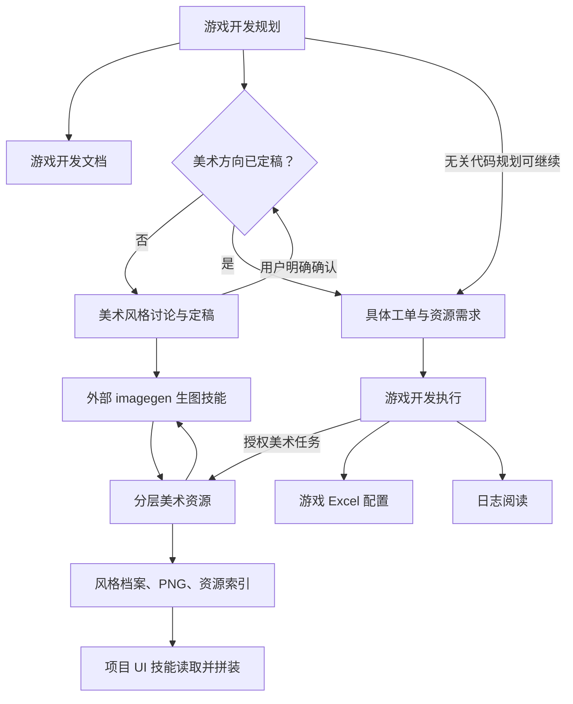

# 游戏系统开发技能

个人级 Codex 技能，面向游戏系统开发，支持项目实际使用的编程语言。

| 技能 | 用途 |
| --- | --- |
| game-system-development-planning | 游戏系统开发规划：先文档，后逐类工单、验收标准与依赖 TODO，交付后停止 |
| game-system-development-execution | 游戏系统开发执行：按 TODO 领取、阅读、实现、真实测试报告、验收与完成 |
| game-system-development-documentation | 游戏系统开发文档：扫描现状、增量同步、原语言公开函数 API、独立 docs Git |
| game-excel-config | 游戏 Excel 配置表：字段注释、表关系、端归属及项目固定路径一键导表，独立适配不同语言 |
| log-reading | 日志阅读技能：定位构建/运行日志，关联会话、双端及异常链；含 SCE 可选适配 |
| [game-art-style-discussion](game-art-style-discussion/SKILL.md) | 美术风格讨论与定稿：比较候选、记录反馈、保存完整风格描述与认可参考图 |
| [game-layered-art](game-layered-art/SKILL.md) | 美术资源：效果图分析、文字风格档案、分层生图与复用、资源索引；交付给 UI 技能，不实现界面 |

## 技能协作流程

[技能架构](architecture.md) · [分层美术示例](examples/gamehud-layered-art/README.md)。UI 素材默认不需要背景；背景独立存放和展示。美术技能只处理资源，布局与交互由消费技能负责。各技能流程图位于对应 SKILL.md。

美术制作从 `art-library/art-direction.md` 读取定稿，引用 `styles/<风格ID>/<版本>/style.md` 和同版本 `references/` 中实际保存的图片。未定稿时先讨论风格，无关代码规划继续；纯规划不自动生图。[六版仙侠候选比较](examples/gamehud-layered-art/art-library/productions/xianxia-style-exploration/README.md) 当前为讨论中，等待用户选择。

## 安装

将需要的技能文件夹放到个人 Codex skills 目录（通常为 `~/.codex/skills/`）；保留它们的相邻关系，以便相对引用正常跳转。已有同名技能时，先检查本地修改再更新。

## 使用

可以直接调用“游戏系统开发规划”：先研究代码与需求，内部调用文档能力，再建立工单，默认交付后停止；明确要求落实后由独立执行技能实现；也可单独调用“游戏系统开发文档”，只做文档增删改；配置需求由“游戏 Excel 配置表”协作处理；日志排查调用“日志阅读技能”。

- 规划查阅 API 时，已有框架能力须先给出准确接口、调用/生命周期细节与差距，再询问复用还是重写；已明确选择沿用。
- 开发任务入口：`docs/规划/<任务>/README.md`，每个类独立任务 MD，只引用文档，不复制设计，docs 由独立 Git 仓库维护。
- API 在 docs/文档/<模块>/api/client|server|shared 中存储原语言公开函数声明，由 Markdown 映射；实现完成后同步到正式文档位置。
- 需要 UI 的模块独立写 `ui.md`，链接可直接打开的 HTML 设计稿。客户端业务逻辑的 UI 放模块 View/view；服务端业务逻辑的客户端 UI 直接放对应模块目录，遵循项目实际 UI 框架。
- 配置字段需要完整注释，说明用途、单位、缺省、范围与引用关系。
- 项目特定框架及 Excel 适配以实际项目为准；技能不授权自动推送项目代码或创建远程仓库。

技能入口为各目录的 `SKILL.md`，详细规范与模板在 `references/`、`assets/` 中。
## 各技能专用工具

| 技能 | 工具 | 命令与范围 |
| --- | --- | --- |
| 开发规划 | scripts/planning_tool.py、scripts/task_store.py | init/update/relocate/order/check/list：具体工单与依赖 TODO，共享格式 |
| 开发执行 | scripts/execution_tool.py | next/show/claim/set-item/run-test/record-test/record-acceptance/block/release/reopen/complete：落实与真实报告 |
| 开发文档 | scripts/documentation_tool.py | rules/check：精简 meta、文档依赖、API 和测试分离 |
| Excel 配置 | scripts/config_tool.py、scripts/export_config.py | inspect/check：配置读取与字段处理清单；export_config：按项目配置导出并检查 |
| 日志阅读 | scripts/log_tool.py | read：日志标识过滤、行号和上下文 |
| 风格讨论 | scripts/direction_tool.py | check/handoff：只读检查状态、版本化描述、参考图与摘要；不代替用户定稿 |

每个工具随对应技能安装；执行工具复用相邻规划技能的共享工单模块，使用说明在该技能 references/tooling.md。规划工具可以在显式任务根内记录任务，配置导出工具按项目 profile 写生成产物，--check 调用已核对的检查器，--describe 只读显示路线；文档、配置盘点和日志工具只读。结果为 JSON，结构通过不代表业务/运行验证通过。测试代码不随技能或本仓库分发，分别在隔离目录验证。

更新时间使用便于阅读的 `YYYY-MM-DD HH:mm:ss ±HH:MM`，例如 `2026-10-12 17:19:55 +08:00`；YAML 用带引号字符串。新更新记录与 API 头部按此格式，旧历史不补造时分秒。日志事件的原始时间保持原样。

## 文档先行，规划默认交付工单

文档技能继续维护已认可的系统说明、角色、生命周期、调度图及原语言公开函数 API；本次只补独立 `目录架构.md`，用于定位文件夹和脚本。规划不复制这些内容；每类任务引用对应文档，写目标与勾选工作项，底部保存真实测试过程，所有必需测试与前置完成后才设 completed。Python 工具辅助记录，不执行测试，不替代业务验证。

重构前认可版本已保存为 Git 标签 `backup/before-planning-driver-20261013-204919`，对应提交 `a7864d91ba47c776ce94260a1aa8c2859b4570dd`。

规划工单先填写当前情况与改动、具体工作项和验收标准；执行后追加测试过程与验收情况。文档入口 README.md 与目录架构.md 同级且直接相连。[工单功能验证](examples/game-rule-dispatchers/work-order-review.md)。

## 模块文档布局

当前文档目录为 `docs/文档/<模块>/`，模块内部保存 README、同级目录架构、职责、api/client|server|shared 和需要的专题。根目录只汇总模块/类导航及总目录架构；不再有顶层职责/api。设计资料也归模块的设计任务目录，规划工单引用对应模块入口与类说明。[模块布局验证](examples/game-rule-dispatchers/module-layout-review.md)。

规划类工单镜像文档相对 docs/文档 的路径与文件名，例如文档 GameRule/职责/GameRuleSystem.md 对应规划 <任务>/GameRule/职责/GameRuleSystem.md；只复制目录/命名约定，正文保存工单与测试/验收记录。工具支持 relocate 保留历史迁移。[同层级规划验证](examples/game-rule-dispatchers/planning-mirror-review.md)。

规划技能默认仅写文档和规划工单，交付即停止；实现、测试与验收已抽离至独立执行技能；规划工具不再支持 --execute 或执行记录命令。

[默认只交付文档与规划的验证](examples/game-rule-dispatchers/planning-default-review.md)。

## 三阶段职责与依赖

[技能架构与依赖](architecture.md) 说明文档、规划、执行边界、脚本位置、TODO 领取与测试报告归属。执行工具复用规划工单格式，安装时保持三个技能文件夹相邻。

[执行技能实际验证与流程预览](examples/execution-workflow/README.md)。

含类索引的文档 README 同时提供职责架构图与系统依赖图；[补充与验证](examples/game-rule-dispatchers/readme-diagram-review.md)。
