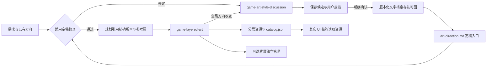
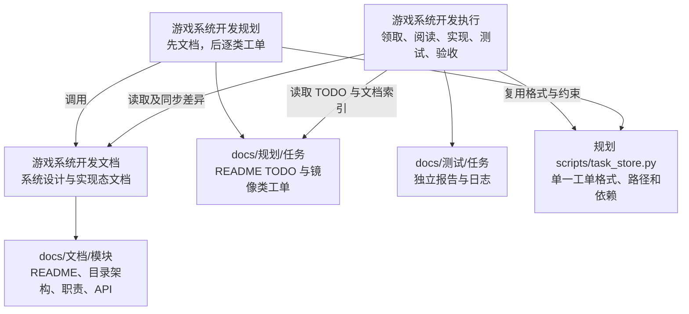

# 技能架构与依赖

## 美术资源支线

[美术风格讨论](game-art-style-discussion/SKILL.md) 使用现有 imagegen 生成请求的候选，保存文字描述、真实参考图与反馈，只有用户明确选择后才更新 `art-library/art-direction.md`。默认全游戏统一方向；更换已使用风格建立新版本，保留旧资料。

[分层美术资源](game-layered-art/SKILL.md) 制作前通过只读 `direction_tool.py handoff` 检查定稿，实际阅读完整描述并查看认可参考图，再使用 imagegen 生产和修正位图。美术工单引用同一份定稿与精确版本，素材局部搭配问题在制作中修正，全局风格改变回到讨论。纯规划不自动生图，未定风格时可继续无关代码规划。



[风格档案规范](game-layered-art/references/style.md) · [消费契约](game-layered-art/references/resources.md)。UI 素材展示默认中性底色，场景背景不参与；本支线不处理 UI 组件、布局或发布。[完整示例](examples/gamehud-layered-art/README.md)。

更新：2026-10-14 09:45:59 +08:00。游戏系统开发分三段：文档描述系统，规划编写工单，执行落实工单。可单独写文档；直接规划时先调用文档；执行已有工单时不重新复制设计。



| 技能 | 操作范围 | 必需依赖 |
| --- | --- | --- |
| [文档](game-system-development-documentation/SKILL.md) | 研究代码/需求，按 SDK 风格增删改系统文档和原语言公开函数 API | 可独立安装使用 |
| [规划](game-system-development-planning/SKILL.md) | 先完成文档，填写具体目标/改动/工作项/标准，按依赖生成入口 TODO | 相邻文档技能 |
| [执行](game-system-development-execution/SKILL.md) | 按 TODO 领取与恢复任务，读取对应 MD，实现、真实测试/报告、验收、完成 | 相邻规划技能的 task_store.py；文档技能用于同步 |
| [风格讨论](game-art-style-discussion/SKILL.md) | 讨论候选、保存参考图、记录用户定稿；只读检查交付入口 | 生图时使用现有 imagegen；与美术技能相邻 |
| [美术制作](game-layered-art/SKILL.md) | 读取定稿、独立素材生成、搭配修正与资源归档 | 相邻风格讨论技能的 direction_tool.py；现有 imagegen |

配置需求按需调用 game-excel-config，日志排查按需调用 log-reading，项目客户端/服务端/UI/单元测试规范按该项目路由加载；不是每次读取全部技能。

## 脚本位置

```text
game-system-development-documentation/   # 原文档能力保持
  scripts/documentation_tool.py
  scripts/planning_documents_tool.py
game-system-development-planning/
  scripts/task_store.py                  # 无命令入口，共享格式/原子写/路径/依赖校验
  scripts/planning_tool.py               # init/update/relocate/order/check/list/rules
game-system-development-execution/
  scripts/execution_tool.py              # next/show/claim/set-item/run-test/record-test/
                                        # record-acceptance/block/release/reopen/complete
```

规划不依赖执行代码，执行单向复用工单格式，避免两个脚本维护不同的格式/完成规则。技能文件夹保持相邻，正式可复用工具随各自技能安装；测试代码在隔离目录，不随技能分发。

## 状态与产物

1. 文档根/模块 README 直接链接同级目录架构、职责类 MD 和 api/client|server|shared。正式文档不包含 TODO、测试或验收过程。
2. 规划入口为 docs/规划/<任务>/README.md。TODO 只存有序 ID 与链接；类工单镜像文档相对路径，状态只存其 meta。初始 todo、工作项未勾选、实际测试未执行。
3. claim 在根级短时锁内按首个就绪任务领取，前置必须 completed，正文短注释记录持有人/时间，状态 doing。实现完成先勾选，不提前完成工单。
4. run-test 真正运行参数列表命令，产生独立报告/日志并追加任务底部；record-test 供已有外部验证报告使用。验收逐项记录；报告不进入正式文档。
5. complete 检查前置、工作项、必需测试与验收最新结果及报告存在，再 completed 并解除领取。失败保留历史；block/release/reopen 使旧通过结果失效。工具不能证明人工填写内容真实或业务测试充分。

文档/规划/报告由 docs 独立 Git 维护；项目代码属于项目 Git。执行技能本身不授权推送生产代码或发布。旧规划的执行命令已移除；旧任务入口先用 planning_tool.py order 补 TODO，不改变类状态和历史。

拆分前版本备份标签：`backup/before-execution-skill-20261014`，指向此前已交付提交 `4c3557412d7ebc4377380fa378ccf41087ddd185`；个人已安装版本另有本地完整备份。
