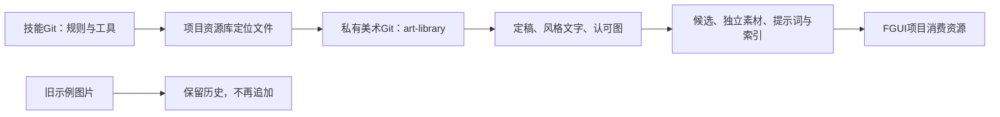

# 技能与FGUI美术仓库分工

| 内容 | 后续维护位置 |
| --- | --- |
| 讨论、分层美术、UI拼接等技能与工具 | 本技能仓库 |
| 新图、风格文字、认可参考、候选、提示词、反馈、catalog | 私有 [fgui-art-library](https://github.com/229196637/fgui-art-library) 的 art-library/ |
| 目标FGUI页面、组件、发布与代码侧交接 | 目标UI项目 |
| 已上传技能示例中的美术图片 | 原样保留为历史存档，后续不追加 |

先读取项目或当前任务仓库 [art-library.location.json](art-library.location.json)。`local_root` 相对定位文件解析；用户明确指定路径时优先使用。定位文件指向的库未就绪时先取得该库或说明缺口，不悄悄回退到旧目录继续写图。没有配置时通用技能仍可用项目art-library/。工具本身不自动发现定位文件，调用方解析后显式传 `--root`。

同级检出时：技能仓库 `game-development-skills/` 与美术仓库 `fgui-art-library/` 并列，实际库根为 `../fgui-art-library/art-library`。库内部相对路径保持不变，整体搬迁仍可通过检查。

```text
python game-art-style-discussion/scripts/direction_tool.py handoff --root ../fgui-art-library/art-library
python game-layered-art/scripts/art_tool.py check --root ../fgui-art-library/art-library
```



本次是复制分离，不从旧仓库删除图片，不重写旧Git历史。新私库的 `import-record.json` 记录源提交、180个文件和原始摘要，便于核对导入完整性。私有性由GitHub仓库设置保证，不公开新增图链接或把新图复制回技能Git。仓库写入和推送仍依据用户授权执行。
