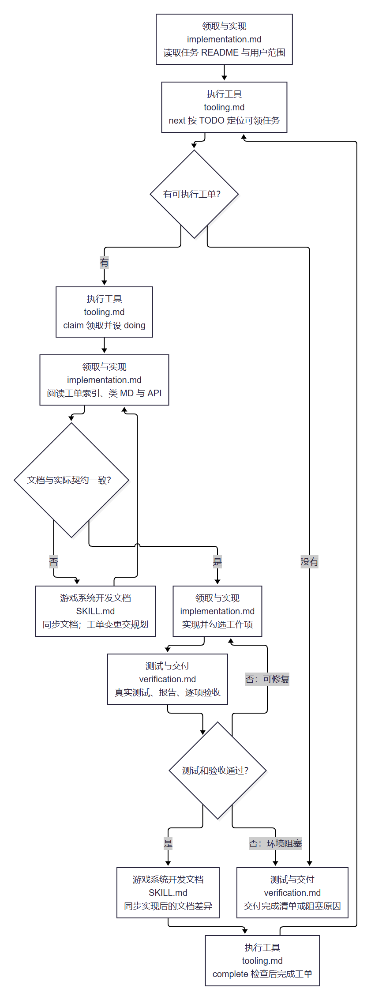
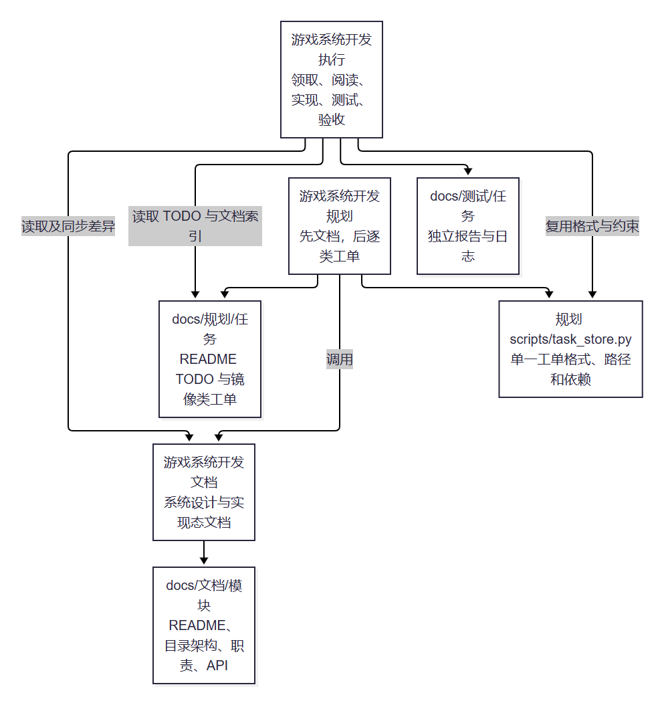

# 执行技能验证

- [技能架构与依赖](../../architecture.md)
- [执行技能入口](../../game-system-development-execution/SKILL.md)
- [工具约束验证](tool-review.md)
- [实际实现验证](implementation-review.md)
- [具体代码与完成工单](sample-project/README.md)
- [样例源码复测](sample-source-review.md)

本目录保存验证结果、阅读预览和 [实际业务代码样例](sample-project/README.md)。临时辅助 Python 和测试程序不加入 Git。

## 执行流程

## 技能依赖

