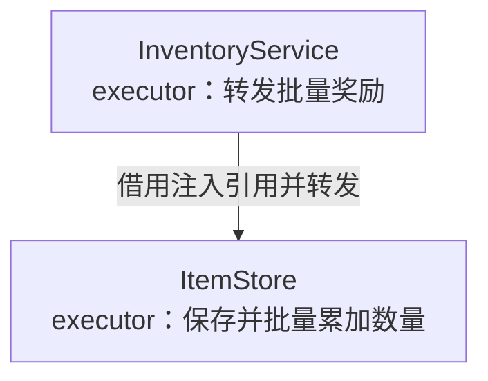
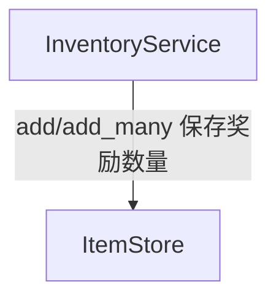

# 文档入口

背包数量存储和奖励服务的已实现用法。先读职责说明，再查询原语言 API。

[目录架构](目录架构.md) · [背包模块](inventory/README.md)

## 类索引

| 类 | 角色 | 职责 | API | 文档 |
| --- | --- | --- | --- | --- |
| ItemStore | executor | 保存并批量累加数量 | [声明](inventory/api/shared/ItemStore.api.pyi) | [职责](inventory/职责/ItemStore.md) |
| InventoryService | executor | 转发批量奖励 | [声明](inventory/api/server/InventoryService.api.pyi) | [职责](inventory/职责/InventoryService.md) |

## 职责架构图

展示类的角色、简短职责及已核实的持有、调用或数据产出关系。

[InventoryService](inventory/职责/InventoryService.md) · [ItemStore](inventory/职责/ItemStore.md)

## 系统依赖图

消费者指向提供者；关系来自类文档依赖与已确认契约，未将开发顺序当作运行依赖。

[InventoryService](inventory/职责/InventoryService.md) · [ItemStore](inventory/职责/ItemStore.md)
