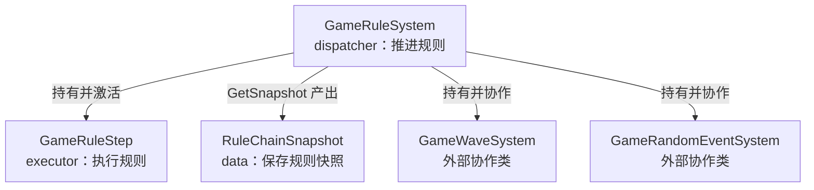
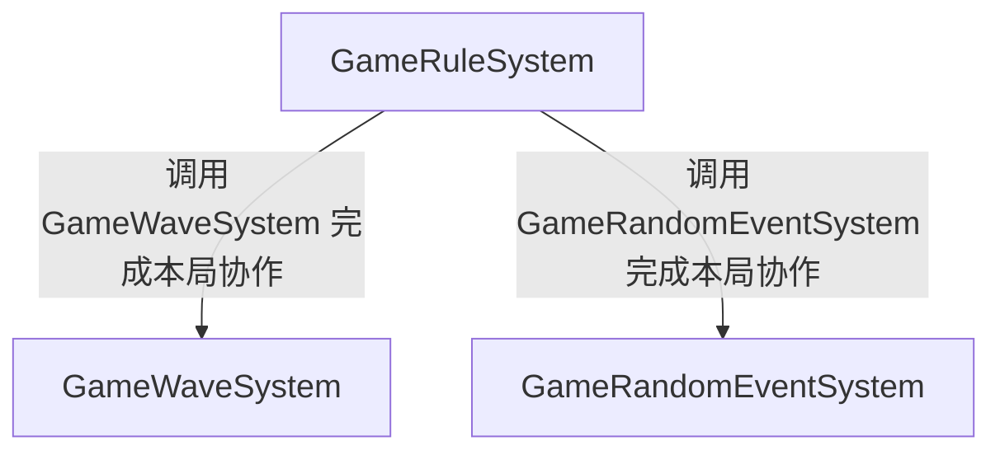

# GameRule

本模块文档入口；按类说明查阅持有、生命周期及公开接口。

[目录架构](目录架构.md) · [职责摘要](职责/README.md) · [API 摘要](api/README.md)

## 类索引

| 类 | 角色 | 职责 | API | 文档 |
| --- | --- | --- | --- | --- |
| GameRuleSystem | dispatcher | 推进规则 | [公开函数](api/client/GameRuleSystem.api.cs) | [GameRuleSystem](职责/GameRuleSystem.md) |
| GameRuleStep | executor | 执行规则 | [公开函数](api/client/GameRuleStep.api.cs) | [GameRuleStep](职责/GameRuleStep.md) |
| RuleChainSnapshot | data | 保存规则快照 | 无公开函数 | [RuleChainSnapshot](职责/RuleChainSnapshot.md) |

[返回总入口](../README.md)

## 职责架构图

展示类的角色、简短职责及已核实的持有、调用或数据产出关系。

[GameRandomEventSystem](../GameRandomEvent/职责/GameRandomEventSystem.md) · [GameRuleStep](职责/GameRuleStep.md) · [GameRuleSystem](职责/GameRuleSystem.md) · [GameWaveSystem](../GameWave/职责/GameWaveSystem.md) · [RuleChainSnapshot](职责/RuleChainSnapshot.md)

## 系统依赖图

消费者指向提供者；关系来自类文档依赖与已确认契约，未将开发顺序当作运行依赖。

[GameRandomEventSystem](../GameRandomEvent/职责/GameRandomEventSystem.md) · [GameRuleSystem](职责/GameRuleSystem.md) · [GameWaveSystem](../GameWave/职责/GameWaveSystem.md)
