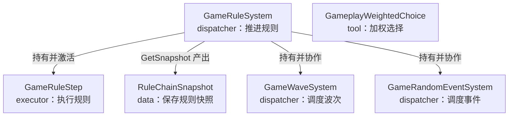
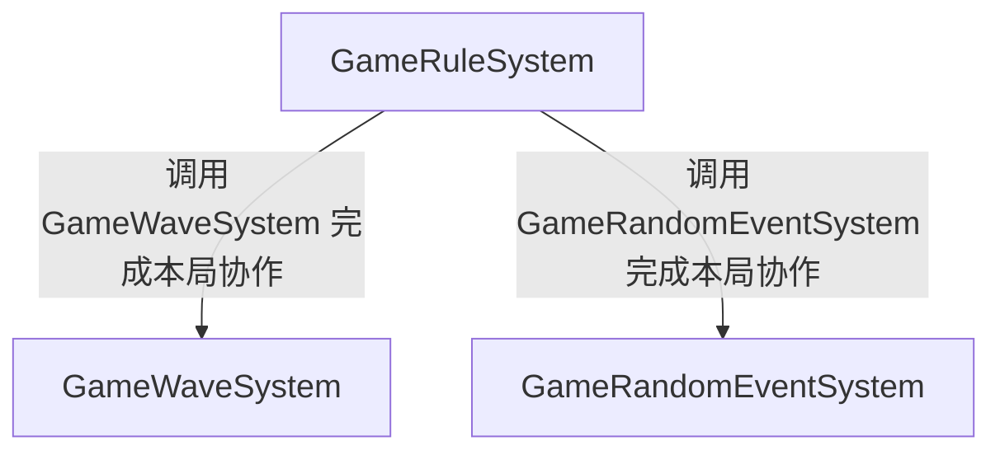

# 系统文档

本入口覆盖当前客户端规则、波次与随机事件的实际模块说明。shared 表示真实共享，不把客户端类型标成 shared。

## 如何查阅

按用途进入实际类型文档，先看每条调度流水线的用途，再通过图中节点或图下链接进入同一/其他调度器的接收流水线。公开函数完整签名由系统 MD 的 API 映射查阅；本导航不复制声明，也不扩大扫描。

## 类索引

| 类 | 角色 | 职责 | API | 文档 |
| --- | --- | --- | --- | --- |
| GameRuleSystem | dispatcher | 推进规则 | [公开函数](GameRule/api/client/GameRuleSystem.api.cs) | [GameRuleSystem](GameRule/职责/GameRuleSystem.md) |
| GameWaveSystem | dispatcher | 调度波次 | [公开函数](GameWave/api/client/GameWaveSystem.api.cs) | [GameWaveSystem](GameWave/职责/GameWaveSystem.md) |
| GameRandomEventSystem | dispatcher | 调度事件 | [公开函数](GameRandomEvent/api/client/GameRandomEventSystem.api.cs) | [GameRandomEventSystem](GameRandomEvent/职责/GameRandomEventSystem.md) |
| GameRuleStep | executor | 执行规则 | [公开函数](GameRule/api/client/GameRuleStep.api.cs) | [GameRuleStep](GameRule/职责/GameRuleStep.md) |
| GameplayWeightedChoice | tool | 加权选择 | 无公开函数 | [GameplayWeightedChoice](GameRandomEvent/职责/GameplayWeightedChoice.md) |
| RuleChainSnapshot | data | 保存规则快照 | 无公开函数 | [RuleChainSnapshot](GameRule/职责/RuleChainSnapshot.md) |

## 子目录

[职责摘要](README.md) · [API 摘要](README.md) · [返回文档总目录](../README.md)

[目录架构](目录架构.md)：查看脚本与文档层级及类映射。

## 模块入口

- [GameRule](GameRule/README.md)：进入该模块的职责、API 和目录架构。
- [GameWave](GameWave/README.md)：进入该模块的职责、API 和目录架构。
- [GameRandomEvent](GameRandomEvent/README.md)：进入该模块的职责、API 和目录架构。

## 职责架构图

展示类的角色、简短职责及已核实的持有、调用或数据产出关系。

[GameRandomEventSystem](GameRandomEvent/职责/GameRandomEventSystem.md) · [GameRuleStep](GameRule/职责/GameRuleStep.md) · [GameRuleSystem](GameRule/职责/GameRuleSystem.md) · [GameWaveSystem](GameWave/职责/GameWaveSystem.md) · [GameplayWeightedChoice](GameRandomEvent/职责/GameplayWeightedChoice.md) · [RuleChainSnapshot](GameRule/职责/RuleChainSnapshot.md)

## 系统依赖图

消费者指向提供者；关系来自类文档依赖与已确认契约，未将开发顺序当作运行依赖。

[GameRandomEventSystem](GameRandomEvent/职责/GameRandomEventSystem.md) · [GameRuleSystem](GameRule/职责/GameRuleSystem.md) · [GameWaveSystem](GameWave/职责/GameWaveSystem.md)
