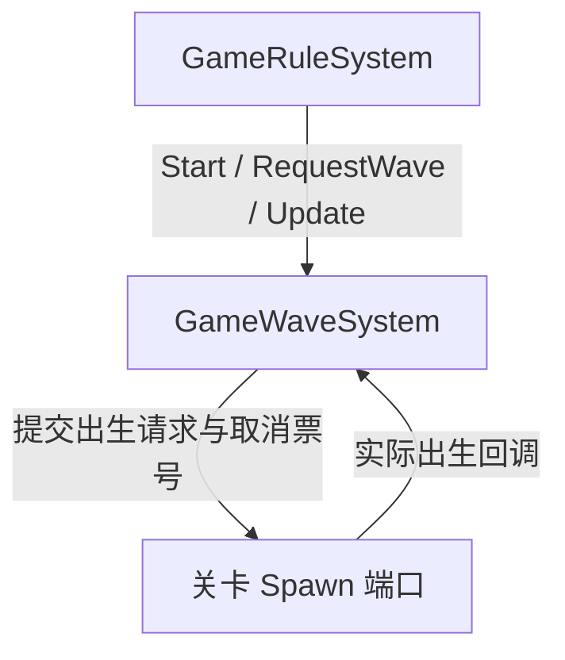
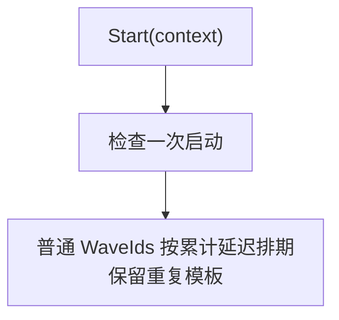
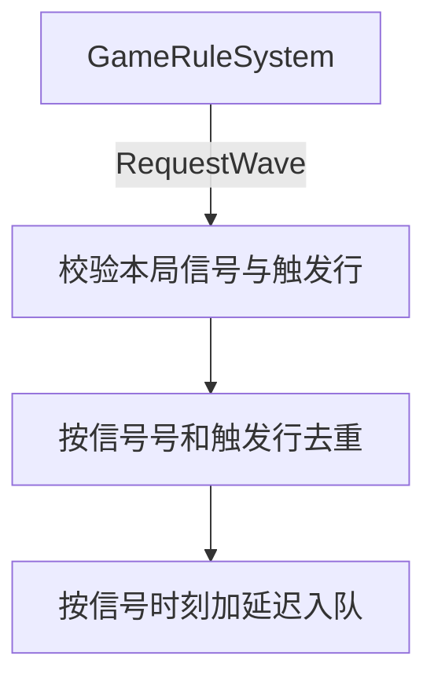
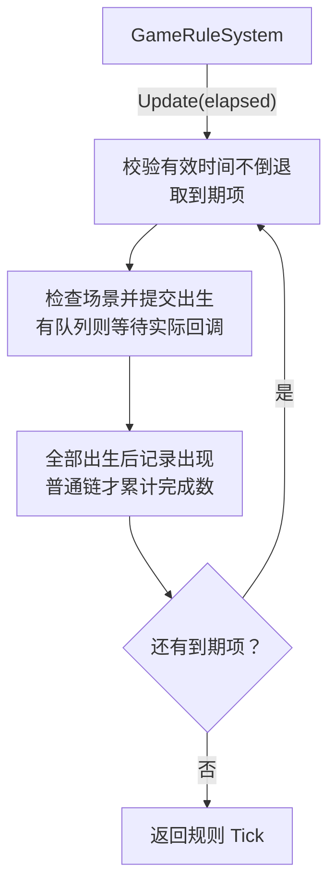
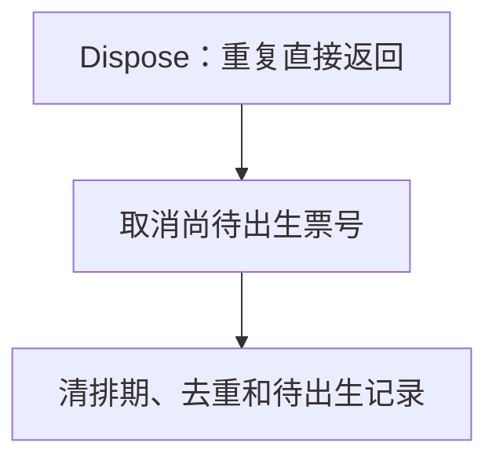

# GameWaveSystem

波次调度器，由 GameRuleSystem 持有；普通链和信号链独立排期，共用本局有效时间。不判定规则胜负。

## 架构

[规则 Tick](GameRuleSystem.md#tick)

## 调度流水线

### 启动排期

用途：启动时为普通波次链计算累计到期时间，只排期而不立即刷怪。

只排期，不立即刷怪。

### 信号触发排期

用途：接收规则调度器的触发信号，校验去重后为额外波次排期。

旧局忽略；配置与来源不匹配报错。触发链不改普通链位置。

[信号消费入口](GameRuleSystem.md#信号消费)

### 到期出生

用途：随有效时间推进提交到期波次的出生请求，并在实际出生完成后记录出现。

重复模板有不同出现号；未到期返回。场景失效时停止并抛异常，不能把请求已提交写成实际已出生。

[规则 Tick](GameRuleSystem.md#tick)

### 停止

用途：取消未到期波次和待出生票号，停止继续生成。

已出生实体由关卡所有者回收，本模块不销毁借用关卡。
