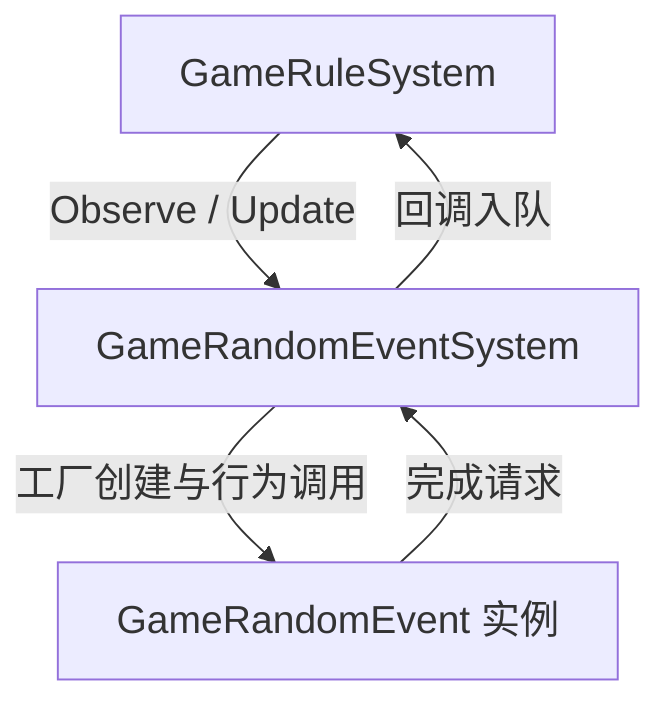
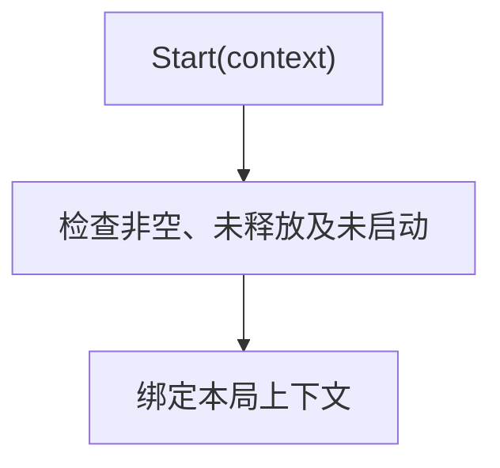
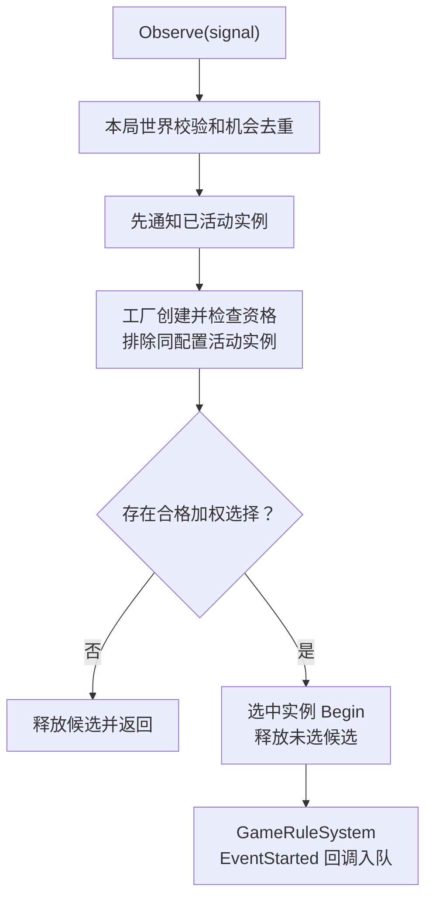
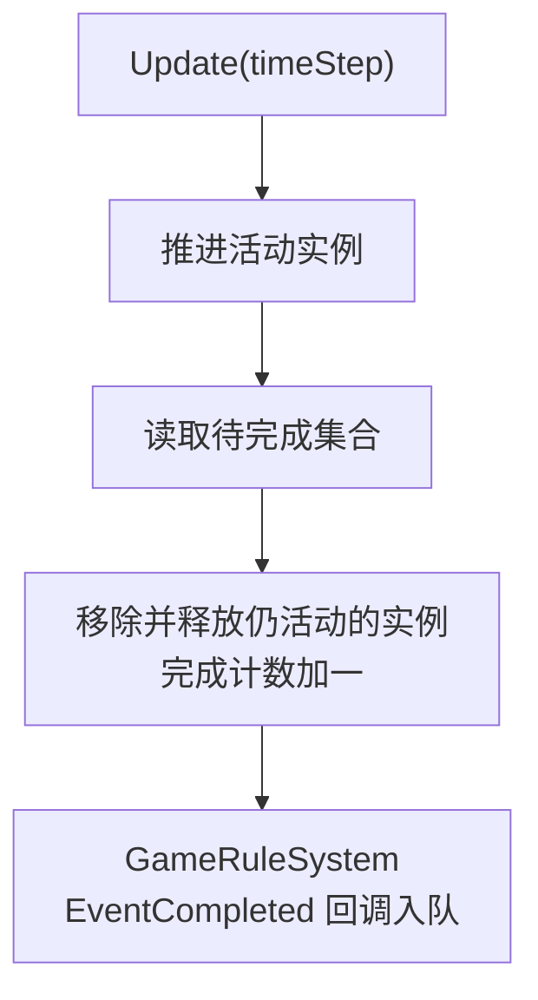
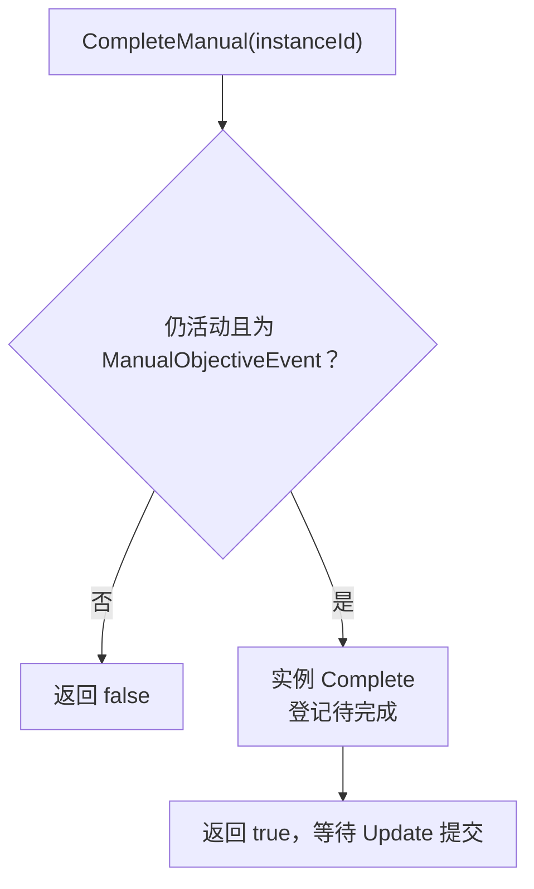
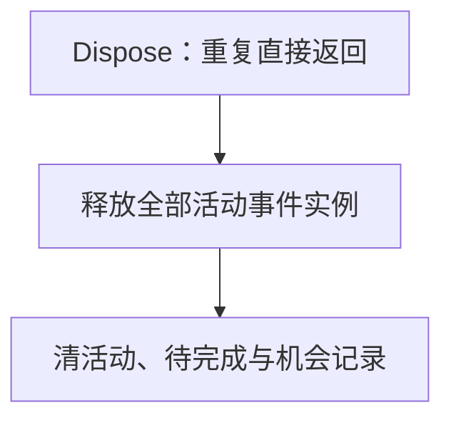

# GameRandomEventSystem

## 职责

随机事件实例调度器，借用注册表、随机源及回调，拥有活动事件实例。开始和完成消息交回 GameRuleSystem 的队列；不直接推进规则或销毁世界。

## 目录架构与脚本位置

当前文件位置已存在；本样例只补录路径，不新增或迁移生产脚本。

```text
src/client/Mod/GameRandomEvent/
  GameRandomEventSystem.cs
```

| 类/模块 | 角色 | 代码文件路径 | 命名空间/模块 | 放置理由与装配者 |
| --- | --- | --- | --- | --- |
| GameRandomEventSystem | dispatcher | src/client/Mod/GameRandomEvent/GameRandomEventSystem.cs | GameEntry.Client.Mod.GameRandomEvent | 事件模块实例调度；GameRuleSystem 创建/持有，借用注册表和随机源 |

## 架构



[规则信号消费](GameRuleSystem.md#信号消费)

## 调度流水线

### 启动

用途：启动时绑定一次本局上下文，为后续机会选择和实例推进准备依赖。



只绑定一次上下文，不立即创建活动事件。

### 机会分派

用途：接收规则信号，通知现有事件并从合格候选中选择一个新事件启动。



新实例不回溯消费触发它的机会。Begin 失败移除并释放实例，再抛出；Start 只绑定一次上下文。

[开始信号接收方](GameRuleSystem.md#信号消费)

### 活动实例推进

用途：逐帧推进活动事件，并提交已登记的完成请求给规则调度器。



实例完成回调只登记请求，Update 才提交完成消息。暂停时调用方不推进。

[完成信号接收方](GameRuleSystem.md#信号消费)

### 手动完成输入

用途：将外部完成输入交给匹配的手动事件，等待有效帧统一提交结果。



这个输入不直接推进时间或规则，也不将接受输入当成完成消息已提交。

### 停止

用途：结束所有活动实例并清空完成请求，不发出完成消息。



停止不发送完成信号；借用注册表与随机源不由本模块释放。

## API

[公开函数声明](../api/client/random-events/GameRandomEventSystem.api.cs)。
