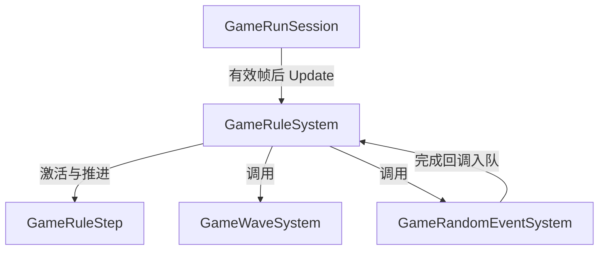
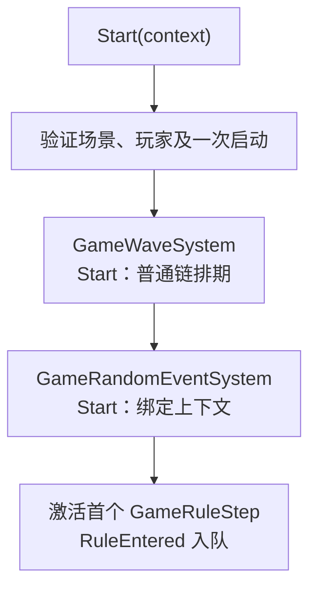
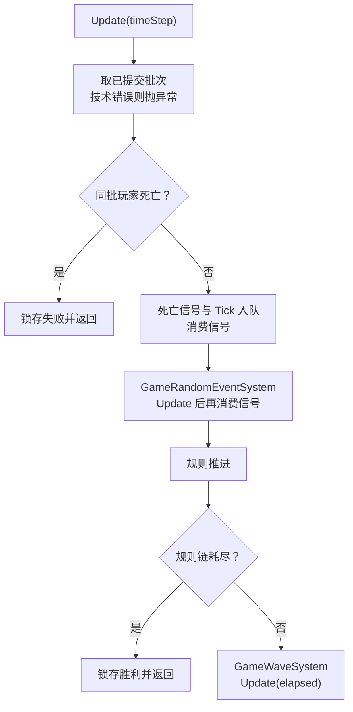
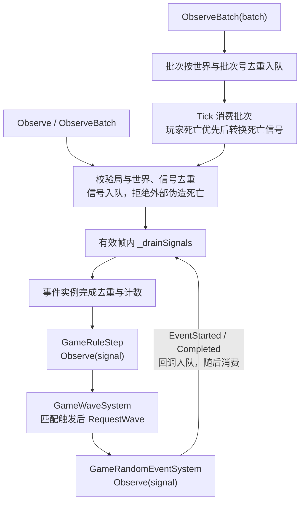
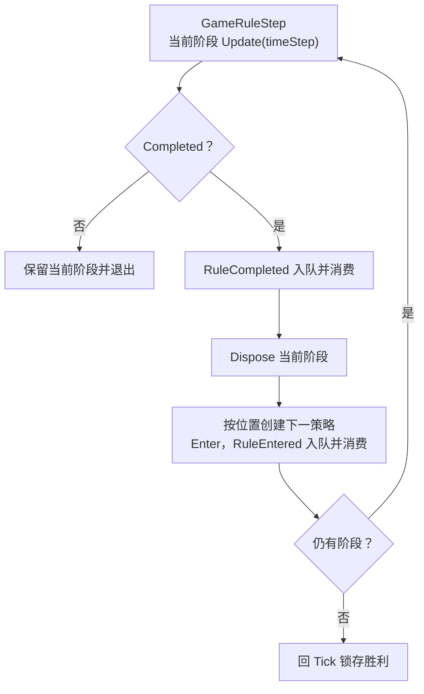
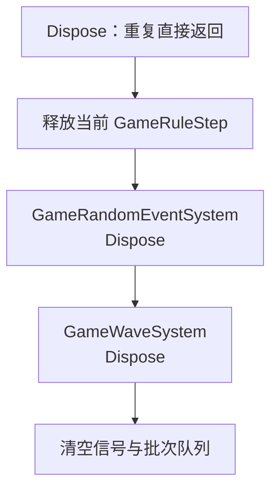

# GameRuleSystem

本局规则调度器。借用关卡上下文与随机源，拥有当前 GameRuleStep、波次和随机事件子模块；只锁存结果，不在规则回调中释放世界。GameRunSession 在有效帧结束后驱动 Update。以下各条链均来自当前实现。

## 架构

[波次调度](game-wave.md) · [随机事件调度](random-event.md) · [执行者](../../文档/systems/game-rule-step.md)

## 调度流水线

### 启动

Start 不在回调中递归推进规则。首规则可能在 Enter 请求 Boss 出生，但提交出生不等于立即完成。

### Tick

结果已锁存则 Update 返回；有效时钟先加本帧时间再判死亡。即使 Boss 完成消息更早，同帧玩家死亡仍优先。暂停由驱动不推进有效帧，不使用墙钟。

### 信号消费

这里的循环是队列消费，不是同步递归调用规则推进；实例完成按唯一实例号计数。外部 Observe 不接受伪造死亡；旧局、旧世界和终局信号按实现忽略，非法本局字段报错。

### 规则推进

链位置只激活一次，循环由有限规则链限制。已满足的全局规则可在同一帧继续推进；波次链耗尽不决定胜负。

### 停止

GameRunSession 先解除批次/帧回调再 Dispose Rules；Rules 不销毁借用关卡或世界。

## 执行者

见 [GameRuleStep](../../文档/systems/game-rule-step.md)，只负责具体完成条件；激活顺序、有效时间、累计计数和终局由本调度器控制。
