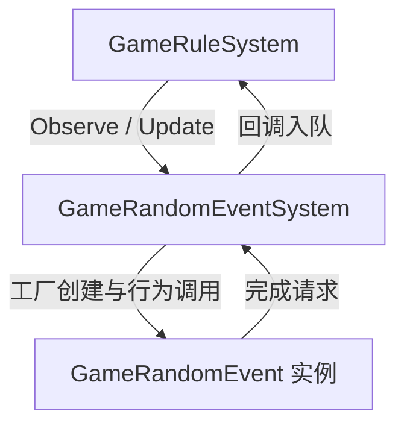
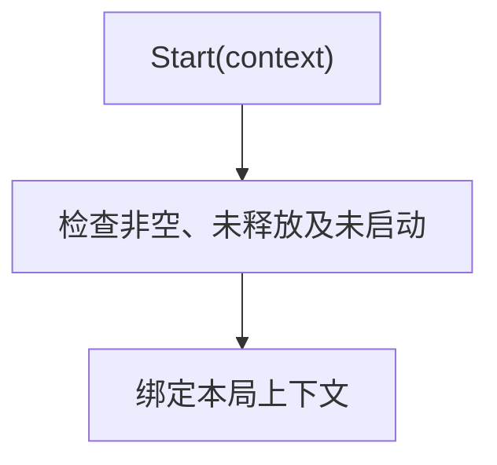
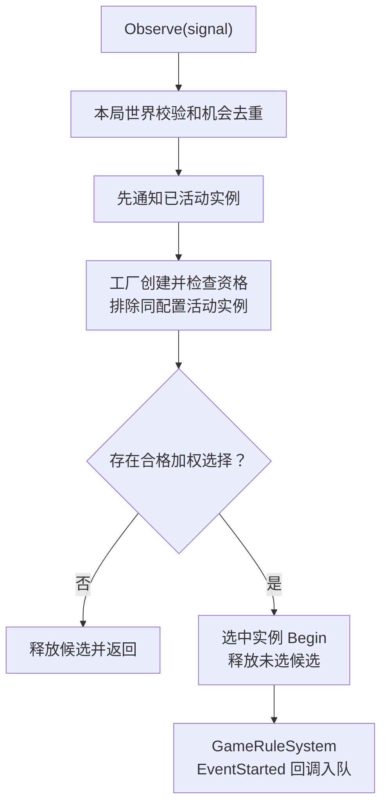
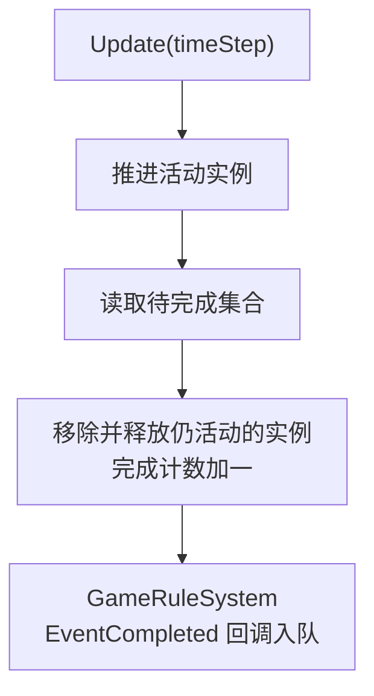
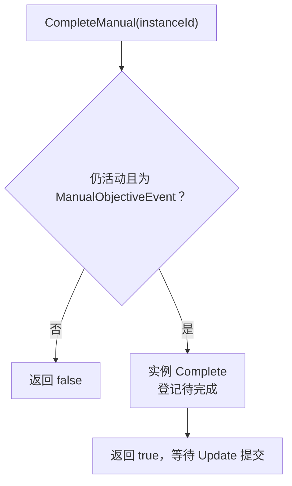
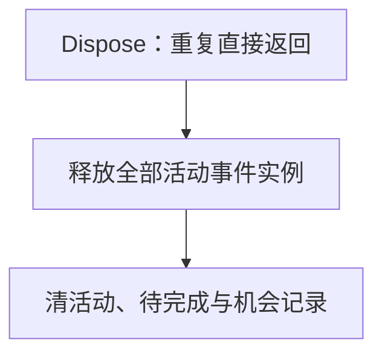

# GameRandomEventSystem

随机事件实例调度器，借用注册表、随机源及回调，拥有活动事件实例。开始和完成消息交回 GameRuleSystem 的队列；不直接推进规则或销毁世界。

## 架构

[规则信号消费](game-rule.md#信号消费)

## 调度流水线

### 启动

只绑定一次上下文，不立即创建活动事件。

### 机会分派

新实例不回溯消费触发它的机会。Begin 失败移除并释放实例，再抛出；Start 只绑定一次上下文。

[开始信号接收方](game-rule.md#信号消费)

### 活动实例推进

实例完成回调只登记请求，Update 才提交完成消息。暂停时调用方不推进。

[完成信号接收方](game-rule.md#信号消费)

### 手动完成输入

这个输入不直接推进时间或规则，也不将接受输入当成完成消息已提交。

### 停止

停止不发送完成信号；借用注册表与随机源不由本模块释放。
