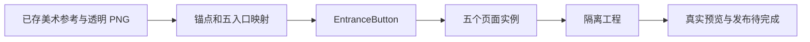

# UiCompositionDemo

独立 FairyGUI 示例：1920×1080 画布，商店、任务、副本、好友、邮件五实例复用同一个 [EntranceButton](source/UiCompositionDemo/assets/UiCompositionDemo/item/EntranceButton.xml)。仅 UI 表现，没有业务或绑定代码。

**当前交付为源工程，真实预览与资源导出尚未完成。** [验证记录](review/validation.md) 列出已完成检查与编辑器限制；没有用美术组合图冒充 FGUI 预览。

打开 [UiCompositionDemo.fairy](source/UiCompositionDemo/UiCompositionDemo.fairy)，查看包 UiCompositionDemo 中同名页面。底座、主体与文字独立，默认不包含场景背景。素材保留 1254×1254 原 PNG；显示尺寸由 FGUI loader 以设计像素配置。

[布局分析](analysis.md) · [映射 JSON](mapping.json) · [组件说明](components.md) · [技能入口与流程图](../../game-ui-composition/SKILL.md)

已实际渲染的可点击流程图：[技能入口](review/flowcharts/entry.svg) · [组件抽象](review/flowcharts/components.svg) · [隔离导出](review/flowcharts/export.svg)。SVG 内链接指向同一 GitHub 仓库对应文档。

本例沿用已有 [青玉鎏金修正参考图](../gamehud-layered-art/art-library/productions/gamehud-v3/previews/effect-1920x1080.png) 演示拼接，不代表最终游戏美术方向。实际生产须读取资源库当前美术定稿及精确版本。



复现工具步骤（在技能仓库根运行）：

```powershell
python game-ui-composition/scripts/composition_tool.py inspect --project examples/game-ui-composition/source/UiCompositionDemo
python game-ui-composition/scripts/composition_tool.py check-mapping --project examples/game-ui-composition/source/UiCompositionDemo --mapping examples/game-ui-composition/mapping.json
python game-ui-composition/scripts/composition_tool.py prepare-export --project examples/game-ui-composition/source/UiCompositionDemo --destination <新的隔离目录> --packages UiCompositionDemo
```

现有插件快照放 [integration](integration/README.md)，属于制作工具，未生成 C#。需要桥接时复制到独立工程的 plugins 并加载；仅使用已支持的 CommandQueue 和 API。字体随源工程保存，原文件 SHA256 可从验证记录核对。发布成功后再检查实际 FUI、图集、字体和三类表现清单。

代码侧交接：后续自行绑定五个入口、加载包及字体、加载文字和按钮表现清单。此例不定义点击业务、禁用规则或数据刷新。
