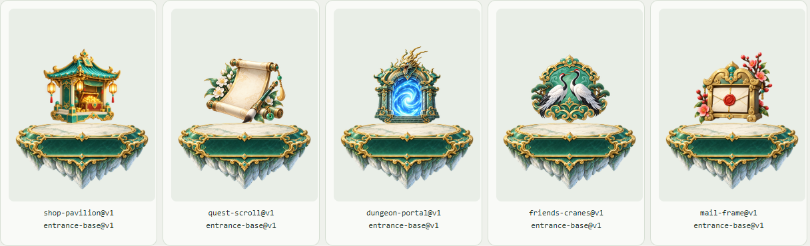
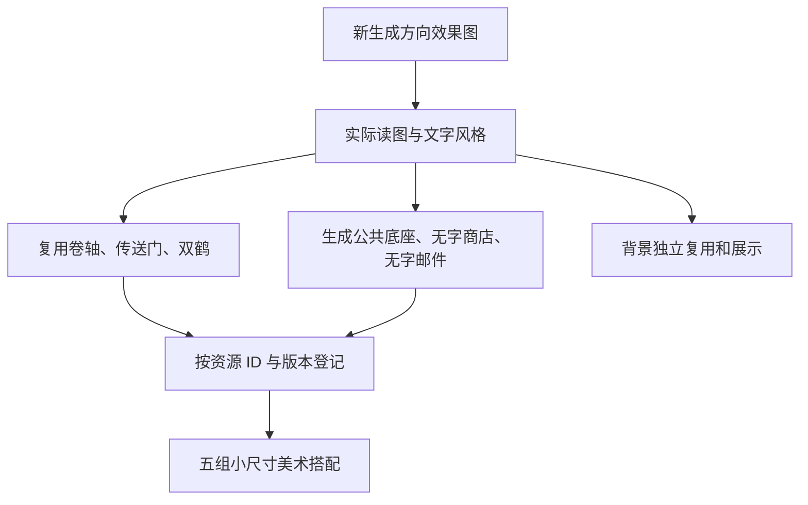

# GameHud 分层美术资源示例

本目录已上传的美术资料保留为历史存档。后续新图、风格和生产记录改在私有 [fgui-art-library](https://github.com/229196637/fgui-art-library) 维护；实际位置读取项目/任务仓库 `art-library.location.json`，见 [拆分说明](../../art-repository.md)。不向本存档追加新美术。

这是美术资源生产与管理示例。展示效果图分析、可复用文字风格、已有素材复用、缺失素材独立生图、公共底座引用和资源交付。UI 布局、控件与交互由后续技能负责。

当前风格讨论：[六版仙侠候选比较](art-library/productions/xianxia-style-exploration/README.md)。从 [美术方向入口](art-library/art-direction.md) 查看状态，目前没有选定新风格。

历史制作示例：[主体与底座美术修正版 v3](art-library/productions/gamehud-v3/README.md)。五主体以实际底座参考重绘，已通过组合视觉检查；[复验报告](verification-v3.md)。旧例作为不协调问题的对照保留，不代表新风格已定稿。

新增 [1920×1080 名称与原大小检查](art-library/productions/gamehud-v2/README.md)：每项下方显示中文名称、PNG 原尺寸与设计目标，含独立原图 1:1 检查区；精确尺寸导出状态如实标注。[子代理复验](verification-v2.md)。



- [风格档案与方向参考](art-library/styles/xianxia-jade-gold/v1/style.md)
- [读图分析与复用决定](art-library/productions/gamehud-v1/analysis.md)
- [资源索引](art-library/catalog.json)
- [生产与组合清单](art-library/productions/gamehud-v1/manifest.json)
- [本地打开美术预览](art-library/productions/gamehud-v1/previews/index.html)：中性底色素材搭配，背景在独立区
- [验证记录](verification.md)



## 其它技能如何取用

在仓库根运行，按用途和标签检索，然后指定版本获取。输出路径相对 `--root`；消费方读取 style_path，再查看素材决定实际 UI 布局。

```powershell
python game-layered-art/scripts/art_tool.py find --root examples/gamehud-layered-art/art-library --style xianxia-jade-gold --tag entrance
python game-layered-art/scripts/art_tool.py get --root examples/gamehud-layered-art/art-library --id entrance-base --version v1
python game-layered-art/scripts/art_tool.py check --root examples/gamehud-layered-art/art-library
```

复用其它用途的示例：新 UI 需要邮件主体时取 `mail-frame@v1`；需要同风格新主体时读取 style.md 的固定提示词片段与参考图，生成新资源 ID，并在新任务清单引用 `entrance-base@v1`。查不到指定资源返回缺口，不自动改用另一套风格。

示例没有修改 FairyGUI 工程或发布资源。素材原始尺寸与预览显示比例分开记录；复用的小图为 128×128，新生成素材以实测尺寸为准，不承诺满足项目固定图标档位。
