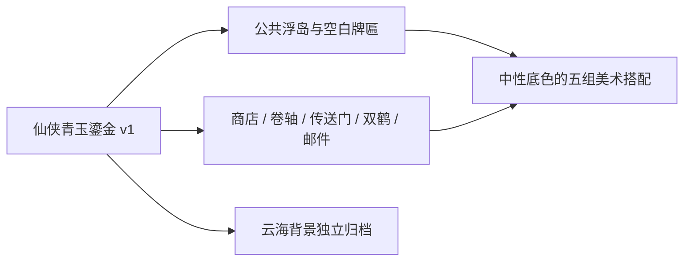

# 效果图分析与复用决定

实际查看了新生成的方向效果图及当前五个独立图标。效果图是 1672×941，不能把它声明成已达到 1920×1080。主体之间的底座造型非常接近：扁椭圆浮岛、青玉牌匾、鎏金框，适合抽象为公共资源。

| 层 | 观察与处理 |
| --- | --- |
| 场景 | 蓝白云海、山体与远方宫殿；独立背景资源，仅在单独展示区查看，不参与 UI 组合 |
| 公共底座 | 五个入口都有相似结构；单独生成一个空顶面底座，各主体引用同一资源版本 |
| 商店 | 建筑与宝箱语义清晰；效果图和原 ui_shop_icon 有字符，重新生成无字主体 |
| 任务 | 原 ui_quest_icon 的卷轴空白、透明度正确、无公共底座；128×128 小图直接复用 |
| 副本 | 原 ui_dungeon_icon 的蓝光传送门风格匹配、无公共底座；128×128 小图直接复用 |
| 好友 | 原 ui_friends_icon 的双鹤与青玉装饰盘匹配、无公共浮岛；128×128 小图直接复用，装饰盘属于主体 |
| 邮件 | 原 ui_mail_icon 的封印有字符；重新生成只有几何封印的无字主体 |

已有背景是干净的 1920×1080 云海图，符合场景档案，因此独立复用，不重新生图。此背景不会成为 UI 制作的默认依赖。

不进行效果图裁切或抠图，不把预览中的文字当美术输出。高分辨率底座与新主体采用显示缩放搭配现有小图；示例使用小尺寸组合，不把 128 图标放大用于正式大入口。后续需要更大主体时，以同一风格版本生成新的明确尺寸资源版本。

## 分层关系

[风格档案](../../styles/xianxia-jade-gold/v1/style.md) · [美术预览](previews/index.html) · [生产清单](manifest.json)
