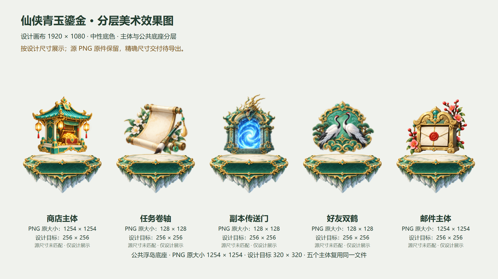
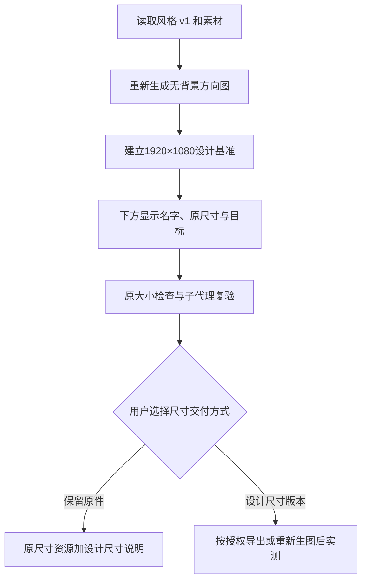

# 1920×1080 美术尺寸检查

本次重新生成了无场景背景的方向效果图，并建立精确 1920×1080 的美术检查图。每个主体下方显示中文名称、PNG 原大小、设计目标和匹配状态；名称是预览文字，不进入独立 PNG。

[打开预览与原大小检查](previews/index.html) · [设计尺寸清单](manifest.json) · [新生图原件](source-images/concept-v2.png) · [实际生图提示词](prompts/concept-v2.txt)

## 当前状态

设计基准为 1920×1080；本例的主体目标 PNG 为 256×256，公共底座目标 PNG 为 320×320（包含透明留白，可见浮岛轮廓约 302×152）。这些尺寸是本例选择，不是技能要求所有项目统一使用的数值。

目前复用原件：商店、邮件、底座为 1254×1254；卷轴、传送门、双鹤为 128×128。设计检查图按目标尺寸显示，但原件没有缩放导出。因此状态明确为 design-reference，不能声称已完成原尺寸交付。下方原大小检查区逐图按 PNG 实测像素 1:1 显示，较大图可滚动查看。

精确尺寸导出等待用户选择：保留模型原件，允许等比例生成设计尺寸版本；或只保留原尺寸并标注设计使用尺寸。若选择按设计尺寸交付，1254 图可等比例导出为新版本；三个 128 图需重新生成更清晰原件，不能放大后声称质量达标。尺寸操作遵循用户选择与当前图像工具规则。

新模型方向图实测 1672×941，不能冒充 1920×1080 原件；精确 1920×1080 的交付图是基于真实素材的标注检查截图，方向原件单独保留。素材独立分层，没有场景背景。

## 流程

[尺寸清单](manifest.json) · [独立测试记录](../../../verification-v2.md)
