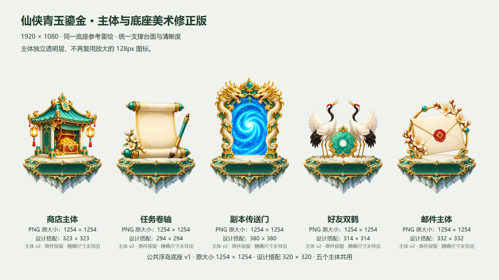

# 主体与底座美术修正版

五个主体围绕同一个实际底座重新生图，独立透明层保持可复用。修正了旧组合里的模糊、漂浮、视角不一致、重复地台和徽章贴片问题。没有裁切效果图，没有修改运行 UI。



[查看组合与原大小素材](previews/index.html) · [问题与修正分析](analysis.md) · [资源/锚点清单](manifest.json) · [实际生图提示词](prompts/) · [视觉与工具验证](../../../verification-v3.md)

## 使用修正版

- 主体：shop-pavilion、quest-scroll、dungeon-portal、friends-cranes、mail-frame 的 `v2` 版本。
- 公共底座：`entrance-base@v1`，五个主体引用同一文件。
- 风格：`xianxia-jade-gold@v1`，材质、照明和视角沿用档案，主体造型按匹配台面修正。
- 原件均为 1254×1254；设计画布 1920×1080。原像素、设计显示比例和接触点分别记录，PNG 未程序缩放或裁切。

在仓库根读取具体版本：

```powershell
python game-layered-art/scripts/art_tool.py get --root examples/gamehud-layered-art/art-library --id quest-scroll --version v2
python game-layered-art/scripts/art_tool.py find --root examples/gamehud-layered-art/art-library --tag paired-art
```

消费方读取 pairing 的原像素接触点与任务清单的底座支撑点，再按自身设计尺寸映射。此示例的可见主体宽约266px，底座画布320px；各主体透明留白不同，PNG 显示画布尺寸不同。传送门纵向造型更高，保持可见宽度协调。

本次视觉协调检查通过；精确设计尺寸 PNG 的导出仍是独立事项。旧版资源与旧组合保留用于问题对照，不自动替换已有消费者的版本引用。
