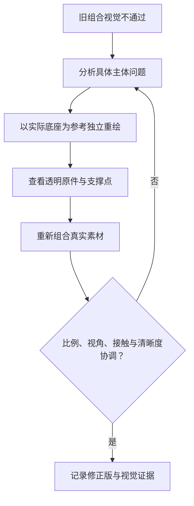

# 主体与底座协调修正

用户指出 v2 的主体与底座不搭配。实际查看组合与新方向参考，并由独立子代理复核，旧组合美术验收不通过；文件检查通过不能覆盖这个结论。

| 主体 | 旧组合问题 | 修正要求 |
| --- | --- | --- |
| 商店 | 建筑自带厚装饰地台，和公共浮岛叠出两层平台；落点在后沿 | 底层只保留薄建筑地面，落在公共台面中央 |
| 任务 | 128 小图放大模糊，斜向悬浮卷轴没有清楚接触面 | 重绘直立卷轴，下卷轴成为清楚的平直支撑 |
| 副本 | 128 小图放大模糊，自带阶梯和脚台，门框倾斜 | 重绘正面双龙门，两根柱脚接触台面，不含台阶 |
| 好友 | 128 小图放大模糊，大徽章加云纹底边像贴片 | 重绘完整双鹤，脚可见；中间小玉环不包围主体，不带云纹底框 |
| 邮件 | 厚门框和块状脚台像图标牌，不像台上物件 | 重绘立体信封与薄支架，细脚接触台面，避免第二块厚底座 |

五项都用实际 `entrance-base@v1` PNG 作为材质、视角和接触参考，再用认可的整体效果参考约束主体语义。每项独立生图，保留透明层，不裁切效果图。

组合统一比较可见主体宽度与底座可用台面，而非直接统一 PNG 画布。底座原件的人工支撑锚点为 (627,520)；该点位于象牙白台面内，不在后沿。各主体实际支撑脚/下轴/薄地面落到这一支撑高度，主体显示在底座上方，不用整个台面覆盖主体底部。

## 修正回路

[真实组合](previews/index.html) · [独立素材与组合清单](manifest.json)
