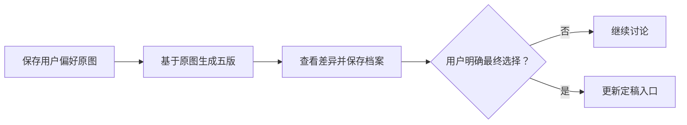

# 纸艺融合五版讨论

[比较页](index.html) · [本轮候选记录](selection.json) · [定稿入口](../../art-direction.md) · [保存的用户偏好原图](../../styles/xianxia-paper-collage/v1/references/user-preferred-v1.png)

用户：“这一版不错 基于这个 再来5版本看看吧 我觉得融合 舒服。 先存下来这个”。

该反馈表示偏好并要求继续比较，没有最终定稿。本轮以用户原图为实际参考，通过内置imagegen生成五张新图，按原像素保存，名称在各项下方。

| 编号 | 融合方向 | 原图 | 风格描述 |
| --- | --- | --- | --- |
| 1 | 纸艺融合·柔彩水洗 | [原图](../../styles/xianxia-paper-collage/v2/references/concept-v1.png) | [文字档案](../../styles/xianxia-paper-collage/v2/style.md) |
| 2 | 纸艺融合·雅致岩彩 | [原图](../../styles/xianxia-paper-collage/v3/references/concept-v1.png) | [文字档案](../../styles/xianxia-paper-collage/v3/style.md) |
| 3 | 纸艺融合·圆润轻卡通 | [原图](../../styles/xianxia-paper-collage/v4/references/concept-v1.png) | [文字档案](../../styles/xianxia-paper-collage/v4/style.md) |
| 4 | 纸艺融合·工笔细线 | [原图](../../styles/xianxia-paper-collage/v5/references/concept-v1.png) | [文字档案](../../styles/xianxia-paper-collage/v5/style.md) |
| 5 | 纸艺融合·简洁平涂 | [原图](../../styles/xianxia-paper-collage/v6/references/concept-v1.png) | [文字档案](../../styles/xianxia-paper-collage/v6/style.md) |

## 最新反馈：游戏简化稿

用户要求停止扩展风格，减少细节并加强游戏感。[简化原图](../../styles/xianxia-paper-collage/v7/references/concept-v1.png) · [简化档案](../../styles/xianxia-paper-collage/v7/style.md)。原基准和前五版均保留，简化稿尚未最终确认。
