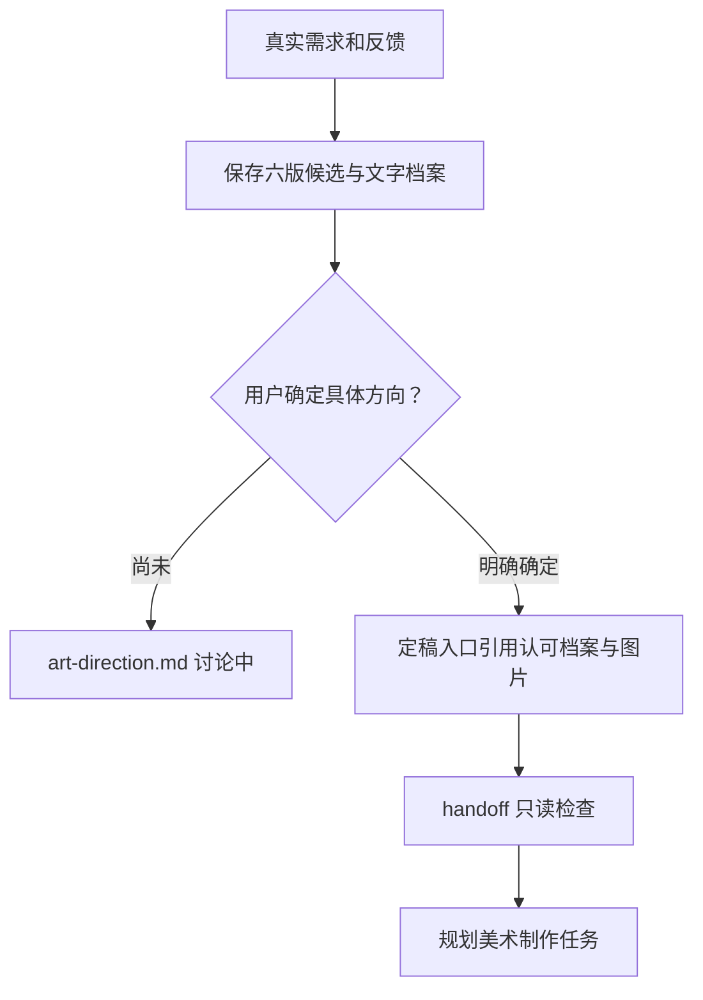

# 仙侠美术风格讨论示例

六个候选采用相同五个入口和中性底色，便于比较艺术语言。文字风格、实际提示词和生图原件都已保存，默认整个游戏统一方向。

[定稿入口：当前讨论中](../../art-direction.md) · [真实反馈](discussion.md) · [候选记录](selection.json) · [浏览器比较页](previews/index.html) · [验证记录](../../../verification-style-discussion.md)

| 候选 | 视觉方向 | 带素材名字的效果图 | 风格文字 |
| --- | --- | --- | --- |
| A 水墨淡彩 | 烟青淡墨，素雅留白 | [预览](previews/ink-1920x1080.png) | [描述与原图](../../styles/xianxia-ink-wash/v1/style.md) |
| B 国风工笔 | 月白玉色，细线层染 | [预览](previews/gongbi-1920x1080.png) | [描述与原图](../../styles/xianxia-gongbi/v1/style.md) |
| C 清新卡通 | 薄荷桃粉，柔和体块 | [预览](previews/cartoon-1920x1080.png) | [描述与原图](../../styles/xianxia-fresh-cartoon/v1/style.md) |
| D 写意水墨 | 墨色笔势，简练写意 | [预览](previews/expressive-1920x1080.png) | [描述与原图](../../styles/xianxia-expressive-ink/v1/style.md) |
| E Q版二维卡通 | 大形状、平涂、活泼可爱 | [预览](previews/qcartoon-1920x1080.png) | [描述与原图](../../styles/xianxia-chibi-2d/v1/style.md) |
| F 块面风格化3D | 几何切面，哑光白石青瓷 | [预览](previews/faceted-1920x1080.png) | [描述与原图](../../styles/xianxia-faceted-3d/v1/style.md) |

生图原件实测1672×941，标注检查图1920×1080；当前是整体风格效果，未拆出独立素材。候选尚未获得定稿确认。



在仓库根检查当前讨论记录：

```powershell
python game-art-style-discussion/scripts/direction_tool.py check --root examples/gamehud-layered-art/art-library
python game-art-style-discussion/scripts/direction_tool.py handoff --root examples/gamehud-layered-art/art-library
```

check应返回valid=true、ready=false；handoff应退出2并报告风格未确定。当前示例不建立虚假的确认记录；工具测试的confirmed记录仅在隔离目录作为测试数据，不改变这里的真实状态。

## 第二轮新增候选 G–I

使用内置 imagegen 新生成三版，保留原件，不缩放；名称位于每项下方。原尺寸与1920×1080设计基准分别记录，未分层为运行素材。

| 编号 | 名称 | 参考图 | 风格文字 |
| --- | --- | --- | --- |
| G | 剪纸拼贴仙侠 | [原图](../../styles/xianxia-paper-collage/v1/references/concept-v1.png) | [完整风格](../../styles/xianxia-paper-collage/v1/style.md) |
| H | 敦煌岩彩仙侠 | [原图](../../styles/xianxia-dunhuang-mineral/v1/references/concept-v1.png) | [完整风格](../../styles/xianxia-dunhuang-mineral/v1/style.md) |
| I | 赛璐璐动漫仙侠 | [原图](../../styles/xianxia-anime-cel/v1/references/concept-v1.png) | [完整风格](../../styles/xianxia-anime-cel/v1/style.md) |

本轮三版和原六版均为讨论中；没有用户选择，不更新为已确认。实际读图差异和偏离目标的细节已写入各版档案。
