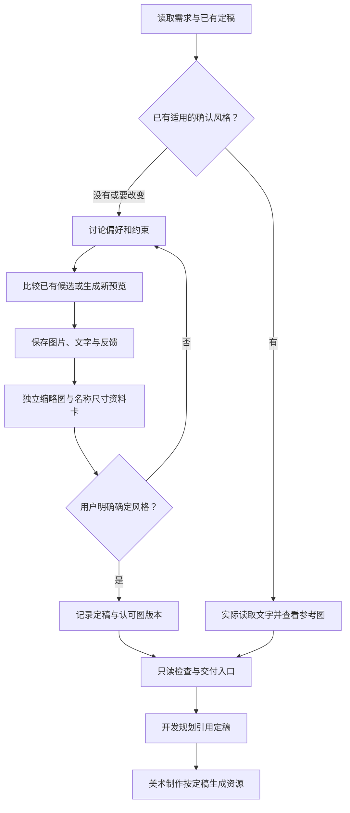

# 美术风格讨论与定稿

默认整个游戏统一风格。用户明确指定模块或其他范围时记录实际范围，不自行拆成多套风格。用 [skill 的交付契约](references/direction-contract.md) 管理 `art-library/art-direction.md`：这是规划与美术制作读取的唯一风格决定入口；完整文字和参考图沿用资源库现有的版本化风格目录。

资源库位置优先沿用用户指定路径，其次读取目标项目或当前任务仓库的 `art-library.location.json`，将 `local_root` 相对该文件所在目录解析。已配置独立美术 Git 时，新图片、风格、提示词和反馈写入该库，检查工具以实际库根作为 `--root`；旧示例只作历史存档。没有定位文件时才使用项目 `art-library/`。定位与 Git 分工见 [定稿契约](references/direction-contract.md)。

## 流程

[讨论方法](references/discussion.md) · [定稿契约](references/direction-contract.md) · [检查工具](references/tooling.md) · [定稿入口模板](assets/art-direction-template.md)

## 工作顺序

1. 读取项目、范围和已有定稿；适用且已经明确确认的选择沿用，不每次重新问风格。要改变已确认方向时保留旧档案，进入新一轮讨论。
2. 先了解用户想呈现的感觉、受众、艺术表现、复杂度、可用素材和避免项。只问会改变方向的偏好；不把游戏类型直接当成唯一画风。
3. 用户需要看效果时使用当前环境的 `imagegen` 技能。先复用适用候选，保持相同功能、布局和比例方便比较，再按反馈补图。只讨论文字或纯规划时不自动发起生图。
4. 实际查看每版图片，记录文字风格、提示词与反馈。图片复制到版本目录，不能仅留聊天附件、外链或工具默认输出目录；见 [定稿契约](references/direction-contract.md)。UI 默认中性底色，背景单独处理；示例名称用外部文字层，设计基准默认1920×1080，模型原尺寸另记。
5. 只有用户明确确定具体方向及所需修改后，才将入口写为 confirmed，记录真实决定及对应风格版本、认可图和校验值。喜欢某版、代理推荐或测试通过不等于用户定稿；仍有未确定的改动则继续讨论。
6. 运行只读工具 handoff，交付定稿入口、风格文档和参考图。结构检查不能证明记录的用户选择真实，操作者必须核对实际用户消息。讨论技能交付后停止，独立素材制作交给美术技能。

## 协作

大参考图也需要独立缩略图用于比较页，复用相邻美术技能的[预览工具](../game-layered-art/references/tooling.md)。每图下方标明名称、资源文件名、原图像素/体积和缩略图像素/体积；点击查看保存的原件。缩略图只是浏览副本，不改变风格参考、原图尺寸或用户确认记录。

游戏开发规划先检查定稿，缺失时先讨论再确定美术任务，无关代码规划可继续。文档与工单引用同一入口及风格版本，不复制另一套描述。美术制作必须读取定稿全文、所指文字和图片；局部素材不搭配由美术技能修正，要变整体画风则回到本技能。无美术内容的任务无需建空定稿。

独立使用本技能不要求先调用游戏开发规划。完整示例在仓库 [仙侠六版风格讨论](../examples/gamehud-layered-art/art-library/productions/xianxia-style-exploration/README.md)；单独安装技能时示例可能不随安装分发。
