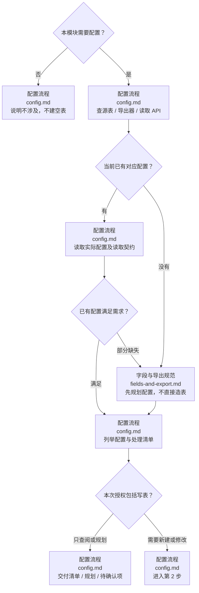
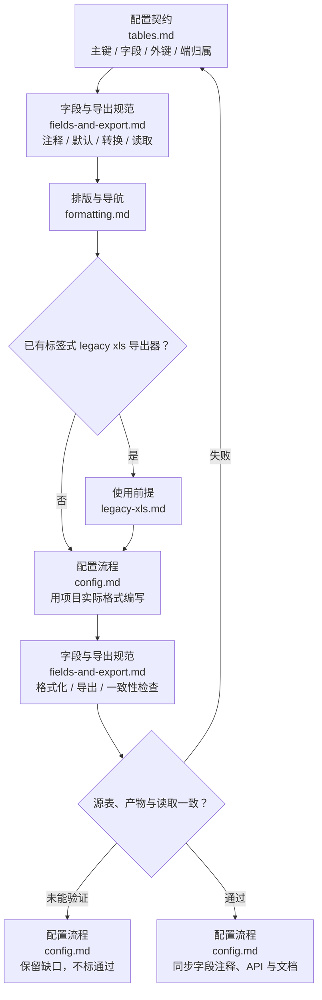

# 游戏 Excel 配置表

个人级游戏开发技能，跨项目/语言使用。需要配置先查已有配置；有则读取核对，无则先规划再按任务授权编写。图中操作节点链接到对应技能规范，图下保留 Markdown 链接。

## 配置工具（优先执行）

优先使用 [配置工具](references/tooling.md)：inspect 只读盘点配置，缺失时提示先规划；check 专门检查配置规划 meta、字段注释和处理清单，不写表或执行导出。

## 1. 判断需要读取还是规划编写

| 判断 | 操作 | 必须说明 |
| --- | --- | --- |
| 不需要配置 | 不建空表、空 config.md | 本模块为何不涉及配置 |
| 配置已有且够用 | 读源表、导出结果和实际读取 API，直接复用 | 表/Sheet、端归属、字段语义、真实调用与缺省；无变更不重新造表/导出 |
| 配置部分缺失 | 保留已有表/Id/语义，只规划缺口 | 新增/修改的字段、兼容影响与读取差距 |
| 配置缺失 | 先写模块 config.md，列字段与导出/读取契约 | 按 [字段与导出规范](references/contracts/fields-and-export.md) 和 [配置模板](assets/templates/config.md) 规划，不先写生产配置 |
| 需新建/修改 | 按已明确任务授权写表并验证 | 纯规划不导出、不安装工具；实际修改才运行已查阅的项目链路 |

具体定位、读取与决策遵循 [配置流程](references/workflows/config.md)。已有框架读取能力先列准确接口、用法和差距；涉及替代读取器时遵循规划技能的 [已有框架能力与重写选择](../game-system-development-planning/references/workflows/framework-reuse.md)，询问复用还是重写，已有明确选择沿用。

## 2. 规划完成后编写、导出与核对

依次读取 [配置契约](references/contracts/tables.md)、[字段与导出规范](references/contracts/fields-and-export.md)、[排版与导航](references/contracts/formatting.md)。[标签格式适配](references/adapters/legacy-xls.md) 仅用于已有同类工具的项目，不推广为所有项目的表格式。缺少导出器先明确工具缺口和范围，不假装已有，也不擅自另造生成工具。

## 3. 列举配置与处理清单

每次围绕配置的规划/修改，按表或字段列出以下清单；纯查阅可直接给回答，已有 config.md 时增量更新，不复制一套重复字典。

| 表 / Sheet / 字段 | 现状及证据 | 处理方式 | 读取 API / 消费者 | 影响及检查 |
| --- | --- | --- | --- | --- |
| 实际或拟定名称 | 已有 / 缺失 / 部分缺失；真实路径和端归属 | 读取复用 / 新增规划 / 新建 / 修改 / 保留待确认 | 已实现函数直接映射；新接口标 planned | 兼容影响、字段/外键/端导出及读取验证 |

完整字段字典仍由 [字段与导出规范](references/contracts/fields-and-export.md) 维护：逐字段说明含义、单位、类型/格式、必填/空值/默认/特殊值、Id/外键、client/server 使用方和导出/读取映射。每字段注释必填，同步 config.md、Excel TIPS/说明列和生成原生注释；不能用注释声称未实现的校验。

## 同步与交付

规划 config.md 保存到 docs/规划/<任务>/<模块>/；任务入口维护唯一 TODO。字段是配置说明，不塞入公开函数 API。新增读取公开函数按项目实际语言存任务 api/<端>/<模块>/，与 [游戏系统开发规划](../game-system-development-planning/SKILL.md) 协作；实现核对后由 [游戏系统开发文档](../game-system-development-documentation/SKILL.md) 移交正式 API 并同步精简主体/配置专题。已实现读取 API 直接链接，不重复声明。

docs 独立 Git；源 Excel 和导出物遵循项目代码/资源归属，不强制移到 docs。采用已有 .xls/.xlsx 和导出链路，不手改生成代码，不把来源项目的 Id=1、命名空间或单机规则当通用业务。

修改后验证类型/注释/缺省、重复或非法 Id、外键、中文/公式、端泄漏、生成一致性与实际读表；变更编译输入时按项目要求构建。未运行写未验证。临时 .py 可保留但不入 Git，精确本地忽略，不忽略所有 Python 源码。
