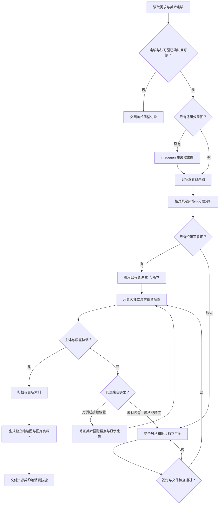

# 游戏分层美术资源

只处理美术资源。先读取项目规范、目标用途、现有风格和素材，复用已有资产，缺失部分调用当前环境的 `imagegen` 技能。内置生图工具是默认路径；不要因批量、透明度或尺寸要求自动改用 CLI。资源库路径由用户指定，否则使用项目 `art-library/`。规划请求只交付分析和资源计划，不启动生图。UI 素材任务默认不需要场景背景：只展示素材和搭配关系，使用中性底色；如有背景需求，单独生成、归档和展示，不叠到 UI 素材预览中干扰布局判断。

正式制作先读取库根 `art-direction.md`，调用相邻 [风格讨论技能](../game-art-style-discussion/SKILL.md) 的 direction_tool.py handoff。未确认、缺少档案或认可图时回到风格讨论；ready=true后实际读取入口、style_file全文并查看reference_images。生产任务记录所用定稿路径与精确风格版本。已有历史资源盘点可以继续，不把候选方向当制作决定。

先按用户显式路径或项目/任务仓库的 `art-library.location.json` 定位资源库；`local_root` 相对定位文件目录解析，并作为所有资源工具的 `--root`。配置了独立美术 Git 时，后续原图、风格参考、提示词、生产清单与索引只写该库，旧示例仅保留。目录未就绪时报告缺口，不回退向旧存档生产新素材；无定位配置时才沿用项目 `art-library/`。

## 工作流程

[风格档案](references/style.md) · [资源契约](references/resources.md) · [生产与验证](references/production.md) · [组合协调检查](references/pairing.md) · [检索与归档工具](references/tooling.md)

## 执行顺序

1. 默认游戏美术设计画布为 1920×1080，用户指定其它基准时沿用指定值。先记录各素材在设计画布中的 PNG 目标尺寸和占用位置，再用资源工具 `find` 查询风格、用途和标签；查看候选图片，不能仅凭文件名判定适用。读取选定风格版本的完整文字说明。
2. 生成或读取效果图，必须实际查看。记录观察到的结构、重复元素、遮挡和推断；不要把推断写成确定事实。
3. 按已确认文字档案和认可图分离主体、公共底座和背景，记录具体素材约束，不自行改整体画风。文字不是本技能交付的默认素材；若用户明确要求文字图案，按具体授权处理。记录拟复用项及不复用原因。
4. 缺失资源每项单独生图，提示词使用风格档案的固定片段、效果图和该项特有约束。透明素材请求真实 alpha。不要默认裁切效果图；明确要求提取时使用 `extract-image-elements`，遵守环境的图像编辑限制。
5. 查看生成结果并检查尺寸、alpha、边缘、杂物、分层和风格；再用真实独立文件做 [组合协调检查](references/pairing.md)。视角、材质、清晰度或主体固有支撑与底座不搭配时，用实际底座作为参考重绘不合格主体，不强行复用。比例或落点不对则修正美术预览的可见占用与接触锚点，再看图。工具生成成功、文件检查或尺寸测试通过均不代表搭配合格；尺寸不达标时重试或报告缺口，不擅自缩放补齐。
6. 通过 `register` 无覆盖归档，记录实际提示词和来源。预览必须在每个素材下方显示易读的素材名字、PNG 实际原尺寸、设计目标尺寸及是否匹配，不只显示英文 ID。1920×1080 美术搭配按设计像素展示，网页整体缩放只为方便查看；原尺寸不达标不能凭 CSS 缩放声明完成。运行 `check` 后交付相对路径、资源 ID/版本、风格版本和组合说明。组合预览只证明素材搭配，不实现 UI。

## 协作边界

大图归档后使用 `scripts/preview_tool.cjs build/check` 生成并核对独立缩略图，不以CSS缩小原图代替。等比缩小、不裁切、不放大、保留透明区域，原图只读；默认最长边640，可按用途调整。每张图下方显示中文名称、资源文件名、原图像素/体积、缩略图像素/体积，点击可查看原图。正式设计尺寸及匹配状态继续单列，缩略图不能用于素材制作或尺寸验收。

游戏开发规划先通过风格讨论确定方向，再引用美术需求和资源契约；执行技能仅在已授权美术任务中调用本技能；文档技能记录最终资源使用约定。改变整体风格交回风格讨论，本技能继续修正单项素材搭配。[game-ui-composition](../game-ui-composition/SKILL.md) 读取索引、版本化风格、锚点和素材，决定实际布局和组件；搭配不合格时回传资源 ID、参考图及修正范围。本技能不写 FairyGUI XML、不新增 UI 行为、不发布资源，不自行安装或更新其它技能。

示例见仓库的 [GameHud 美术资源链](../examples/gamehud-layered-art/README.md)；安装单个技能后仓库示例可能不随安装分发。
