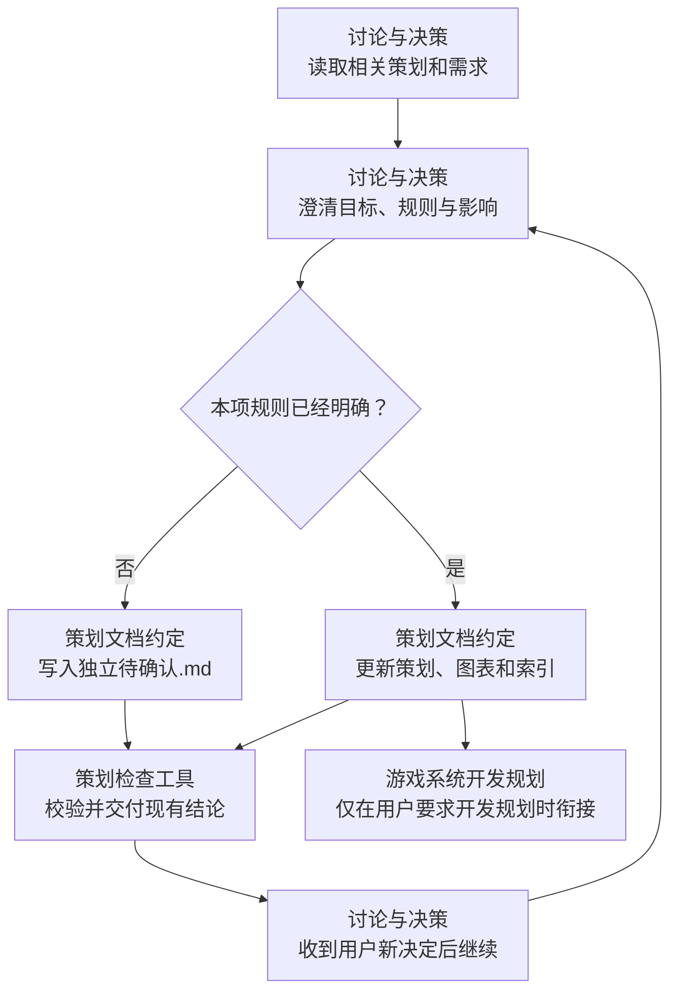

# 游戏策划

先读取项目约定、`docs/策划/README.md` 及相关系统策划，已有确定规则沿用。独立使用不要求先调用开发规划；也可由开发规划在业务不明确时调用。只讨论和维护策划，交付后停止。

## 操作流程

[讨论与决策](references/discussion.md) · [策划文档约定](references/document-contract.md) · [策划检查工具](references/tooling.md) · [系统模板](assets/system-template.md) · [待确认模板](assets/pending-template.md)

## 关键约束

- 按游戏系统分类：`docs/策划/<系统>/README.md`、`策划.md`；有未决问题时单独建 `待确认.md`。每个维护的目录有 README，大系统按真实主题拆分。
- 每系统核心策划至少有一张玩法流程图和一张规则表。流程图表达顺序/分支，表格表达条件/结果/限制，短句说明意图；不重复抄写，不填空章节。
- 用户没有决定的规则、数值、候选方案写入待确认文件。推荐、猜测和已有代码行为都不等于用户已确认的新玩法。明确需求本身可作为决定，无需重复确认。
- 决定后同步正文、图表、依赖及关联索引；待确认记录转为已解决，保留真实决定来源与正文链接，不补造确认。
- 策划不写类/API设计、开发 TODO 或测试执行报告；配置只描述业务字段含义/单位/用途，实际建表导出交给 [游戏 Excel 配置](../game-excel-config/SKILL.md)。
- docs 使用独立 Git；不改 SDK、源码或工单。调用本技能不授权提交生产项目、代码实现或创建 Git 仓库。已有独立 docs 仓库按约定维护，缺失时说明后由用户决定。
