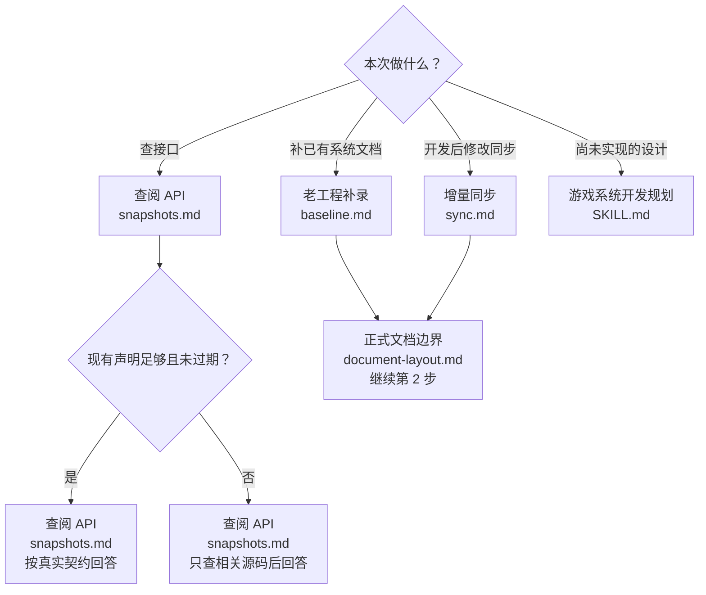
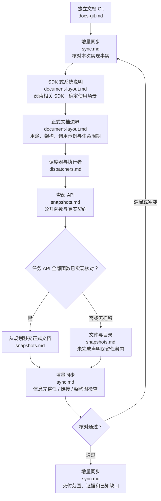

# 游戏系统开发文档

个人级游戏系统文档技能，跨项目、跨语言使用。正式文档参照项目 SDK 的系统说明：先讲用途，再按实际使用场景给短调用示例，说明生命周期与限制；不把扫描结果和检查清单堆成正文。图中操作节点可点击对应规范，名称与文件相对应；图下保留同目标 Markdown 链接。

## 系统文档工具（优先执行）

优先使用 [系统文档工具](references/tooling.md) 的 rules/check，固定检查精简 meta、文档依赖、API 布局与测试内容分离；真实实现、持有关系、生命周期及 SDK 式可读性仍人工核对，结构检查通过不能证明正文好读。

## 1. 按任务选择入口

| 场景 | 对应规范 | 操作边界 |
| --- | --- | --- |
| 查阅接口 | [查阅 API](references/api/snapshots.md) | 系统 Markdown → 原语言声明；足够且无冲突不扫描源码，planned 不当已实现 API |
| 老工程缺文档 | [老工程补录](references/workflows/baseline.md) | 专项追踪创建/运行/释放和公开契约，不补造历史规划 |
| 实现/修复/优化后 | [增量同步](references/workflows/sync.md) | 对照此次实现差异，更新系统及受影响消费者，不覆盖其他改动 |
| 仅设计 | [游戏系统开发规划](../game-system-development-planning/SKILL.md) | 保持规划与正式现状分开，不将未实现设计写入正式说明 |

## 2. 生成或同步实际系统文档

补录任务从第 1 图的 [老工程补录](references/workflows/baseline.md) 进入；先按 [SDK 式系统说明](references/contracts/document-layout.md#sdk-式系统说明) 组织阅读路径；[系统模板](assets/templates/system.md) 是可裁剪骨架，标题按实际操作命名，具体规范如下：

| 步骤 | 阅读规范 | 必须得到的结果 |
| --- | --- | --- |
| 检查仓库 | [独立文档 Git](references/contracts/docs-git.md) | docs 是独立仓库，知道本次范围与用户已有改动 |
| 提炼现状 | [正式文档边界](references/contracts/document-layout.md) | 每系统一份使用说明；用途 → 理解架构 → 最短用法 → 必要场景 → 生命周期 → API 入口；持有与限制就近讲清，不强制职责表或固定章节 |
| 维护 meta | [精简 meta](references/contracts/document-layout.md#精简-meta) | 默认 system、side、updated、code_revision、sources、dependencies；依赖其他文档用 document 与 uses，不在正文重复依赖表 |
| 维护 API | [查阅 API](references/api/snapshots.md) | api/client|server|shared/<模块>/ 原语言公开函数声明及直接映射；保留真实参数/返回/异常与版本信息 |
| 检查遗漏 | [精简后的信息完整性](references/contracts/document-layout.md#精简后的信息完整性)、[增量同步](references/workflows/sync.md) | 初始化前置、owner、成功含义、重复调用、取消/失败及清理限制可从主体/API 恢复；核对链接、架构显示与实际验证 |
| 交付 | [增量同步](references/workflows/sync.md) | 在交付说明区分已核对与未验证；测试内容全部放任务测试文件/独立报告，不进入系统主体或 meta |

普通系统保留架构图；调度器额外为每条主要流水线画实际流程图并链接跨调度器通信。技能操作图与业务流水线图分别维护，不复制规划图冒充实现。

## 调度器与执行者

涉及调度职责时读取 [调度器与执行者](references/workflows/dispatchers.md)。类型/模块 meta 用 roles 标记 dispatcher/executor/tool/data（可兼任）；调度器再记录 dispatcher 与 design_patterns（模式/编排机制及用途）；每条主要流水线先写简短用途再画图；文档文件名、类名与图节点名一致，同调度器和跨调度器调用都链接到目标流水线。执行者只简述执行内容，不复制调度结构。

## 3. 必要专题与核心边界

正式系统文档及其 UI/配置/网络专题不设测试、验收或执行记录章节，也不放简短测试总结。测试方案/用例、验收矩阵、命令与结果、截图/日志证据、扫描/实验记录统一保存在任务的 verification.md 或既有独立测试报告；无需复制进正文或 meta.dependencies。文档操作流程仍要核对正确性，核对动作不代表把报告放进产物。

- UI：读取 [有 UI 时的模块规划](../game-system-development-planning/references/workflows/ui.md)；正式独立 UI 说明与 HTML 设计稿按实际实现维护，客户端业务放模块 View/view，服务端业务的客户端 UI 直接放模块根目录，不复制规划或强制补流程图。
- Excel：读取 [游戏 Excel 配置表](../game-excel-config/SKILL.md)；同步字段注释、表关系、端归属、导出与读取。网络事件等专题按 [正式文档边界](references/contracts/document-layout.md) 独立说明。无需求不补空文件。
- API 仅公开函数/方法，保留真实模块/命名空间与必要类型壳；不收字段、属性、事件、非公开函数或实现体。核对方法体，不照抄可能不完整的 XML；按真实语言输出，不限定 C#。
- 精简不删关键行为；不能将 owned 集合当成底层完整所有权，或把 Dispose 保留/不重试写成“释放全部资源”。不把 planned/mixed 提前移交，不保留双份正式声明。
- 不改 SDK 缓存、自动生成源码/API。不复制规划 TODO、设计推演、伪代码、验收矩阵或历史流水。提交/推送以用户授权为准，交付说明代码/docs 仓库状态。

## 临时 Python 脚本
为扫描、生成或验证本次任务临时编写的 .py 可以保留，但不得加入 Git。优先放在仓库外的临时目录；需要保存在代码或 docs 工作树中时，使用各仓库本地 .git/info/exclude 精确忽略临时目录或文件，不使用全局 *.py 规则，以免隐藏正式源码。分别检查所属仓库的 git check-ignore 和暂存差异，确保临时脚本没有进入提交。发现本任务误暂存的临时脚本，仅撤销其暂存并保留文件，不影响用户已有暂存内容。项目正式 Python 源码、可复用工具和技能自带模板不属于临时脚本，不强制删除。
