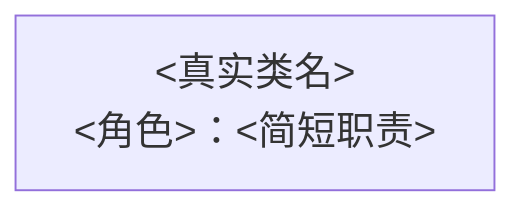

# <游戏开发任务>
本文件保存为 docs/文档/<模块>/设计/<任务>/README.md，是当前任务入口。模块规划分别保存在同任务目录的 <模块1>/、<模块2>/ 中；这里只保存本模块设计资料，执行工单与测试/验收在 docs/规划 的任务目录。规划期 API 存于同任务 api/<端>/，这里及模块规划直接链接；实现核对后由文档技能移动至正式位置并更新这些链接。

## 当前任务详细需求
填写背景、已确认需求、开发目标和可观察预期结果，不只写一句摘要；待确认业务问题另行明确标记。

## 范围与约束
明确本任务包含的模块、改动边界、已有接口及兼容约束；不展开具体实现。任务过长时将专题拆为同目录文件，并在这里提供相对链接。

## 已有框架与复用

先说明本次实际基于的框架/SDK/依赖库或项目现有基础模块及版本/基线，不做全项目能力清单。

| 来源/已有能力 | 接口/文档入口 | 端与使用前提 | 本次复用与缺口 | 决定及范围 |
| --- | --- | --- | --- | --- |
<填写本次相关能力，链接准确 API/系统 MD；细节可链接模块专题，不复制整份接口。>

说明实际调用入口、生命周期/持有者和限制；已有能力只覆盖部分时明确保留部分与新增部分。复用/适配/重写/待确认的决定按会话真实授权填写，重写注明范围；待确认项关联受阻 TODO，不能当成同意。未发现相关现成能力时说明查阅范围和依据，不留空、不虚构。

## 系统路由与依赖
| 系统 | 端归属 | 提供接口 | 消费接口及前置系统 | 规划/系统文档链接 |
| --- | --- | --- | --- | --- |
填写真实系统与链接，接口直接指向原语言 API。依赖图在“系统依赖图”一节维护。

## UI 路由（涉及时）
需要 UI 的模块链接其 ui.md 与 HTML 设计稿，注明业务逻辑执行端和对应客户端 View/模块根目录；无 UI 时删除本节。开发、资源绑定、测试和验收由独立执行工单维护。

## 类索引

| 类 | 角色 | 职责 | API | 文档 |
| --- | --- | --- | --- | --- |
<职责仅写简短功能短语，如“控制技能”“限制技能”，不列调用步骤/生命周期。角色用 dispatcher/executor/tool/data；类名与类型文件一致，API 和文档直接链接。没有公开函数明确写“无公开函数”；尚未补齐写“待补齐”，不能假装没有。>

## 未决设计事项

<注明接口/架构仍需确认的事实；执行状态与证据不写在文档里。>

## 职责架构图

<概括本入口的类职责、角色和协作关系；节点与类索引一致，每个类链接其职责 MD。>

[<真实类名>](<对应职责MD相对路径>)

## 系统依赖图

<说明消费者到提供者的依赖；依赖依据所属文档 meta，不虚构调用。无依赖时明确说明。>

[<系统或类说明>](<对应系统或类MD相对路径>)
