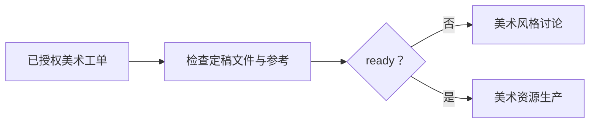
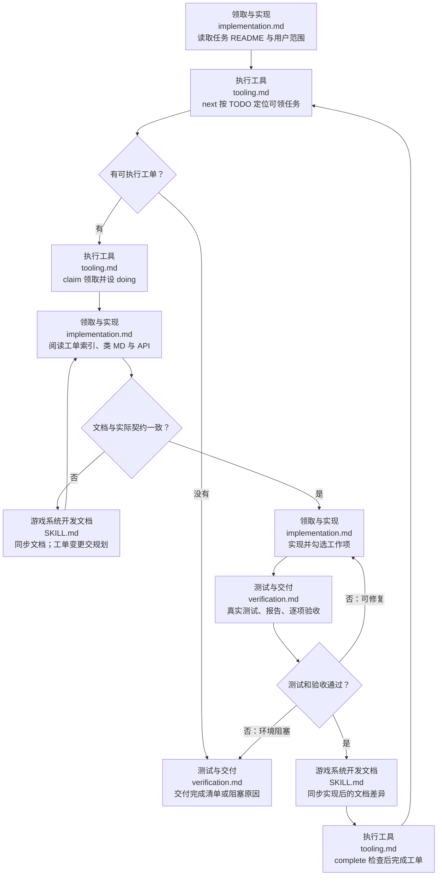

# 游戏系统开发执行

美术工单先沿用用户指定库根，或将项目/任务仓库 `art-library.location.json` 的 `local_root` 相对该文件解析。独立美术 Git 保存新图片、风格与生产记录，技能 Git 保存规则；旧例保留，不再追加美术。调用工具时显式传递实际库根 `--root`。

执行已授权美术工单时先用 [风格讨论工具](../game-art-style-discussion/references/tooling.md) 的handoff检查工单引用的定稿，实际读取风格文字并查看认可图；未确认或缺失时交回风格讨论，无关工单可继续。通过后使用 [分层美术资源](../game-layered-art/SKILL.md) 生成、修正和归档素材，不在执行中猜新画风。UI 工单由项目 UI 技能拼装；默认不把背景叠到素材预览。

以 `docs/规划/<任务>/README.md` 为执行入口。用户明确要求落实该任务才执行；规划交付不会自动启动本技能。先读 [领取与实现](references/workflows/implementation.md)，使用 [执行工具](references/tooling.md) 定位并领取任务。脚本管理顺序、领取、状态及证据；实际代码由执行者按文档编写，不由脚本猜测业务。

## 执行流程

## 依赖与边界

必装相邻的 [规划技能](../game-system-development-planning/SKILL.md)：执行工具复用其 `scripts/task_store.py` 工单格式、镜像路径、依赖和完成检查；执行操作只在本技能内。文档缺漏及实现差异由 [文档技能](../game-system-development-documentation/SKILL.md) 同步。缺少具体工单或 TODO 时回到规划，不凭空执行。

正式系统文档保存职责、架构和公开函数 API；规划类 MD 保存任务与底部测试/验收记录；完整测试报告置于 `docs/测试/<任务>/` 或项目已有独立报告目录，通过任务记录引用，不放 `docs/文档`，不塞入任务根。docs 仍由独立 Git 维护。客户端、服务端、shared、UI/View、网络、配置与语言均遵循对应文档和项目规范。

领取人用稳定 `--owner` 标识，同一任务只能由持有人修改；断点恢复用 show 查看已领任务。执行者只领取用户授权的任务根，不自动推送生产项目、发布或扩大工作范围。临时测试代码/辅助 Python 不提交；正式脚本可提交。
