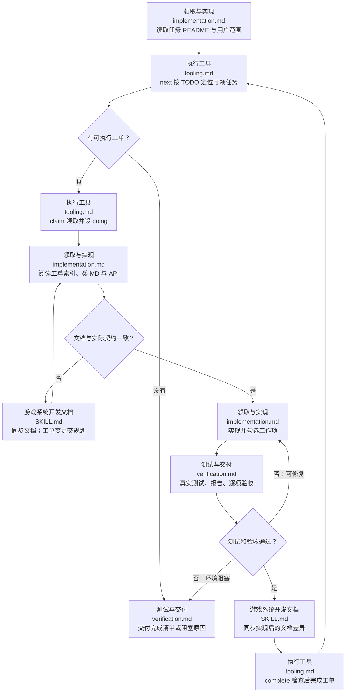

# 游戏系统开发执行

## 按需加载与安装路径

- 按本次实际职责进入技能，遵守宿主的技能调用规则；链接是导航索引，不是加载所有兄弟技能或全部 references 的指令。只读取所选入口及当前步骤需要的契约、模板和专题。
- 同一会话内，完整技能正文或引用已在可用上下文且未变更时直接复用，不为每一步或每个工单反复调用技能工具、重读相同文件。上下文缺失、已压缩而细节不足、文件更新或独立子代理没有收到正文时，再按需获取；不使用跨会话/跨代理全局“已加载”标记。
- 调用 Python 工具、导入共享模块不等于调用其所属技能。只有确实进入另一技能的职责才调用；被调用方完成后返回当前调用者，不反向重启上游流程。不得因此跳过最新工单状态、锁内读取或实际代码核对。
- 脚本和资源以本次加载返回的技能根（如 resourceBase 或 SKILL.md 所在目录）定位，使用绝对路径；项目路径以已核实的项目根定位。不能按客户端名称拼接用户主目录，也不假定当前工作目录就是技能目录。路径示例见本技能 references/tooling.md。

以 `docs/规划/<任务>/README.md` 为执行入口。用户明确要求落实该任务才执行；规划交付不会自动启动本技能。先读 [领取与实现](references/workflows/implementation.md)，使用 [执行工具](references/tooling.md) 定位并领取任务。脚本管理顺序、领取、状态及证据；实际代码由执行者按文档编写，不由脚本猜测业务。

## 执行流程

## 依赖与边界

必装相邻的 [规划技能](../game-system-development-planning/SKILL.md)：执行工具复用其 `scripts/task_store.py` 工单格式、镜像路径、依赖和完成检查；执行操作只在本技能内。文档缺漏及实现差异由 [文档技能](../game-system-development-documentation/SKILL.md) 同步。缺少具体工单或 TODO 时回到规划，不凭空执行。

正式系统文档保存职责、架构和 Markdown 公开函数 API：API 只作简洁速查，保留原语言签名和必要参数/返回/限制并链接职责详情；行为、生命周期、协作与设计约束详写职责，不在 API 重复长说明。规划类 MD 保存任务与底部测试/验收记录；完整测试报告置于 `docs/测试/<任务>/` 或项目已有独立报告目录，通过任务记录引用，不放 `docs/文档`，不塞入任务根。docs 仍由独立 Git 维护。客户端、服务端、shared、UI/View、网络、配置与语言均遵循对应文档和项目规范。

仅查看整体进度时调用相邻规划工具 `dashboard --root <任务根>`：只读 JSON 快照、不写 README、不建锁，consistency.stable=false 显示“更新中”；不替代锁内领取/完成校验。命令与签名查 [API 速查](references/api.md)，读写职责与门禁按需读 [职责说明](references/responsibilities.md)，共享字段契约由规划侧维护。

领取人用稳定 `--owner` 标识，同一任务只能由持有人修改；断点恢复用 show 查看已领任务。执行者只领取用户授权的任务根，不自动推送生产项目、发布或扩大工作范围。临时测试代码/辅助 Python 不提交；正式脚本可提交。
