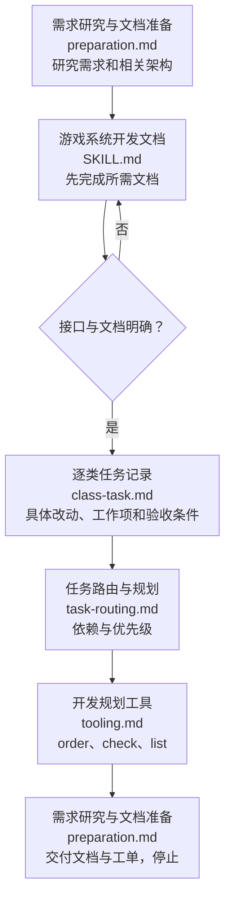

# 游戏系统开发规划

先研究需求和相关已有代码，调用 [游戏系统开发文档](../game-system-development-documentation/SKILL.md) 完成文档，再编写具体工单；校验交付后停止。本技能只规划，用户明确要求落实时使用独立 [游戏系统开发执行](../game-system-development-execution/SKILL.md)，不在本技能实现、构建、业务测试或记录实际验收。文档中的原语言 API 声明属于文档。

## 规划流程

## 工单与入口

任务入口 `docs/规划/<任务>/README.md` 写任务范围、文档入口和 TODO 顺序。先根据模块/类依赖确定前置，再用 order 生成有序 task_id 与类工单链接；同级优先顺序可显式指定。TODO 不重复状态，状态只在类 MD。

每类工单镜像其类文档相对 `docs/文档/` 的目录与命名：`<模块>/职责/<类名>.md`；职责内已有 client/server/shared、命名空间或设计目录也保持，每目录有 README。只建立本任务涉及的类；API、架构图、职责正文不复制到规划。

工单提前填清目标、当前已有/缺失与本次改动、文档索引、具体工作项、验收标准、必需测试 ID、依赖。工作项明确真实文件/方法、动作、约束和交付结果；不能只写“完善模块”。索引链接类 MD、模块 README、同级目录架构及适用 API/网络/UI/配置。框架已有能力先给出准确接口、契约与差距，询问是否重写；已有决策沿用。

正文底部预留测试过程、验收情况，规划时明确未执行且工作项未勾选；实际结果只由执行技能追加。测试/验收计划提前写，但规划本身不运行这些业务验证。文档和工单的结构、链接校验可以运行。

按 [开发规划工具](references/tooling.md) init/update/relocate/order/check/list 操作；不再提供 status、set-item、record-test、record-acceptance、complete 或 --execute。doing 工单先由执行者 release 再修订；规划更新保留历史、退 todo 并使旧结果失效，不覆盖领取中的工作。

文档可独立使用，缺失时依需求增删改并修复引用；根/模块 README 同级的目录架构必须直接链接。docs 独立 Git 维护；临时 Python/测试代码不提交，正式工具可提交。已有旧工单用 update/relocate 补齐或迁移，不借迁移改变完成事实。
