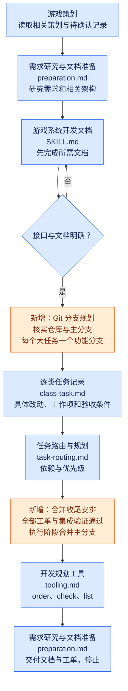

# 游戏系统开发规划

## 按需加载与安装路径

- 按本次实际职责进入技能，遵守宿主的技能调用规则；链接是导航索引，不是加载所有兄弟技能或全部 references 的指令。只读取所选入口及当前步骤需要的契约、模板和专题。
- 同一会话内，完整技能正文或引用已在可用上下文且未变更时直接复用，不为每一步或每个工单反复调用技能工具、重读相同文件。上下文缺失、已压缩而细节不足、文件更新或独立子代理没有收到正文时，再按需获取；不使用跨会话/跨代理全局“已加载”标记。
- 调用 Python 工具、导入共享模块不等于调用其所属技能。只有确实进入另一技能的职责才调用；被调用方完成后返回当前调用者，不反向重启上游流程。不得因此跳过最新工单状态、锁内读取或实际代码核对。
- 脚本和资源以本次加载返回的技能根（如 resourceBase 或 SKILL.md 所在目录）定位，使用绝对路径；项目路径以已核实的项目根定位。不能按客户端名称拼接用户主目录，也不假定当前工作目录就是技能目录。路径示例见本技能 references/tooling.md。

先研究需求和相关已有代码，调用 [游戏系统开发文档](../game-system-development-documentation/SKILL.md) 完成文档，再编写具体工单；校验交付后停止。本技能只规划，用户明确要求落实时使用独立 [游戏系统开发执行](../game-system-development-execution/SKILL.md)，不在本技能实现、构建、业务测试或记录实际验收。API 使用 Markdown 简洁速查，保留原语言签名及必要参数/返回/限制，并链接职责详情；职责文档详述行为、生命周期、协作与设计约束，不把长说明重复塞入 API。两者均属于文档技能。

## 规划流程

图例：蓝色为已有且复用的规划步骤；橙色为本次新增的 Git 规划要求。图中建分支与合并的实际操作均由执行阶段完成。

## Git 分支与任务收尾

- 以一个 `docs/规划/<任务>/` 大任务为分支单位：每次开发新功能，先从主分支建立该任务的独立功能分支，再开展实现；同一大任务内各类工单共用此分支，不按类或工单另建分支，不直接在主分支开发。已有对应任务分支时核实后复用。分支名遵循项目约定，无约定时使用 `codex/<任务标识>`。
- 规划前查阅 Git 状态、分支及仓库约定，核实代码仓库、实际主分支、分支基点与已有任务分支；不默认主分支一定叫 main 或 master。不属于本任务的未提交修改不得覆盖、混入提交或合并。尚未核实的信息明确标为“待核实”，在执行前解决。
- 任务 README 必须写明代码仓库路径、主分支、任务分支、分支基点，以及“创建或复用任务分支 → 按依赖实现各类工单 → 完成测试、验收和文档同步 → 合并主分支 → 验证合并结果”的执行安排。类工单引用任务入口的分支约定，避免各写一套。
- 收尾安排属于大任务级步骤：全部类工单完成、必要集成测试与验收通过、文档同步后，由执行阶段提交本任务改动并合并到主分支；有冲突先解决并重新验证受影响内容。README 写清合并后应运行的检查；尚未合并时，大任务不能宣称已完成交付。无法完成合并时如实记录原因与剩余步骤，不将类工单完成等同于大任务收尾。
- docs 如为独立 Git 仓库，分别记录代码与文档仓库的主分支和任务分支；参与本次修改的仓库各用一个对应大任务的分支，并各自完成验证与合并。不得把独立 docs 仓库当作代码仓库的一部分提交。
- 本技能只生成上述安排，不实际创建、切换、提交或合并分支；用户授权执行任务后按规划落实。合并主分支不等于推送远端或发布，这些动作遵循用户已有授权与仓库规则。

## 工单与入口

任务入口 `docs/规划/<任务>/README.md` 写任务范围、文档入口和 TODO 顺序。先根据模块/类依赖确定前置，再用 order 生成有序 task_id 与类工单链接；同级优先顺序可显式指定。TODO 不重复状态，状态只在类 MD。

每类工单镜像其类文档相对 `docs/文档/` 的目录与命名：`<模块>/职责/<类名>.md`；职责内已有 client/server/shared、命名空间或设计目录也保持，每目录有 README。只建立本任务涉及的类；API、架构图、职责正文不复制到规划。

工单提前填清目标、当前已有/缺失与本次改动、文档索引、具体工作项、验收标准、必需测试 ID、依赖。工作项明确真实文件/方法、动作、约束和交付结果；不能只写“完善模块”。索引链接类 MD、模块 README、同级目录架构及适用 API/网络/UI/配置。框架已有能力先给出准确接口、契约与差距，询问是否重写；已有决策沿用。

正文底部预留测试过程、验收情况，规划时明确未执行且工作项未勾选；实际结果只由执行技能追加。测试/验收计划提前写，但规划本身不运行这些业务验证。文档和工单的结构、链接校验可以运行。

按 [开发规划工具](references/tooling.md) init/update/relocate/order/check/list/dashboard 操作；dashboard 是不写 README、不建锁的 JSON 只读快照，更新中必须显示 consistency 提示，不能据此越过执行领取。入口与签名查 [API 速查](references/api.md)，字段、一致性和模块分工按需读 [职责说明](references/responsibilities.md)。不再提供 status、set-item、record-test、record-acceptance、complete 或 --execute。doing 工单先由执行者 release 再修订；规划更新保留历史、退 todo 并使旧结果失效，不覆盖领取中的工作。

文档可独立使用，缺失时依需求增删改并修复引用；根/模块 README 同级的目录架构必须直接链接。docs 独立 Git 维护；临时 Python/测试代码不提交，正式工具可提交。已有旧工单用 update/relocate 补齐或迁移，不借迁移改变完成事实。
