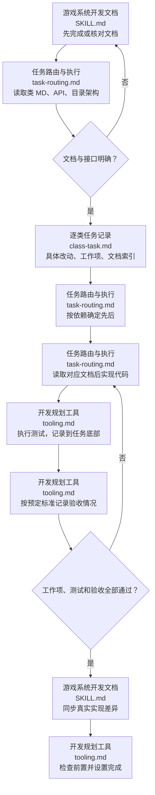

# 游戏系统开发规划

先文档，后规划。先由 [游戏系统开发文档](../game-system-development-documentation/SKILL.md) 明确系统、接口及脚本位置；本技能读取这些成果，把它们变成按类执行的任务。文档不足时先补对应文档，不在规划里另写一套设计。已有系统的改动也先核对并更新相关文档，再安排确实需要的实现工作；纯补录文档不制造代码任务。

## 执行流程

图中节点对应 [任务路由与执行](references/workflows/task-routing.md)、[逐类任务记录](references/contracts/class-task.md)、[开发规划工具](references/tooling.md)。没有执行条件则记录缺口，不把未运行的测试标成通过。

## 开始实现的门槛

首次写本次业务代码之前，必须已有内容完整的对应类工单 MD 及任务 README（范围、文档入口、依赖顺序），执行 `check/list` 核对前置与顺序，并将本类状态设为 doing；之后才能实现和测试。不能先实现再补任务并声称规划驱动。已有代码补录任务须如实写明是补录，不编造过去的执行过程。工具不会监控源码写入时间，执行者负责遵守这个顺序。

## 规划产物

任务入口 `docs/规划/<任务>/README.md`，各类任务放 `<client|server|shared>/<模块>/<类名>.md`，每目录都有 README。无类的语言按真实模块/脚本单元命名。入口只说明任务范围、文档入口和依赖执行顺序，链接各类任务；状态只存每类 MD，不维护第二份 TODO 表。

规划是一套开发工单，不是空壳索引。每类工单提前写清：目标、当前已有/缺失的内容与本次改动、文档索引、具体工作项、可观察的验收标准。工作项写明要改哪个真实文件/方法、做什么、关键约束及交付结果，不能仅写“读取文档”“完善模块”“按文档实现”。如果需求不足以写清具体工作，先核对相关文档或询问未决业务，不凭空填充。

文档索引直接链接对应类 MD、文档 README、与它同级的目录架构 MD，以及本工单需要的 API/网络/UI/配置专题。引用设计依据不等于复制整份职责/API/架构：工单应概括本次变更内容，执行者读工单便知道要做什么，再沿索引查完整契约。

底部依次为 `## 测试过程` 和 `## 验收情况`。规划时提前登记必需测试与验收标准，实际记录表可以暂时无结果，必须明确尚未执行；执行后追加真实测试步骤、预期、实际和证据，再逐条记录验收结果。工作项、必需测试、验收和前置全部满足后才设完成。验收不是新增审批：自动/人工方式按项目与用户已确认要求执行，不能把测试通过直接冒充所有验收标准通过。

实现前每次读对应 MD，沿链接查公开函数 API、目录架构与适用项目规范。现有框架已经提供能力时，给出准确接口、调用契约与差距，再确认是否重写；已有选择继续沿用，不重复询问。实现遵守文档规定的脚本位置和实际语言，不猜接口。

按 [开发规划工具](references/tooling.md) 使用 `scripts/planning_tool.py` 创建/补充工单、勾选工作项、记录测试与验收、排序检查和设置完成。工具只修改显式指定任务根下的任务/README，不实现代码、不运行测试、不修改系统文档；结构通过不等于行为通过。

文档及规划由 docs 独立 Git 维护。测试及验收记录只在规划类任务底部或链接的独立证据中；不进入正式文档。临时 Python 留仓库外或精确本地忽略，不提交；本技能的正式可复用工具可提交。发布或生产改动依用户授权，规划本身不扩大范围。

文档不足时调用文档技能按当前架构增补、修改或清理已失效内容，并修复引用；文档技能也可独立使用。文档入口必须直接列出同级 `目录架构.md`，不能只在深层类说明中出现。

文档先按模块查阅：docs/文档/README.md → docs/文档/<模块>/README.md → 本模块职责/类 MD 和 api/<端>/ 原语言声明。工单索引链接本模块入口及同级目录架构；跨模块通过实际所有者文档跳转，不再指向顶层职责或 api 旧位置。
