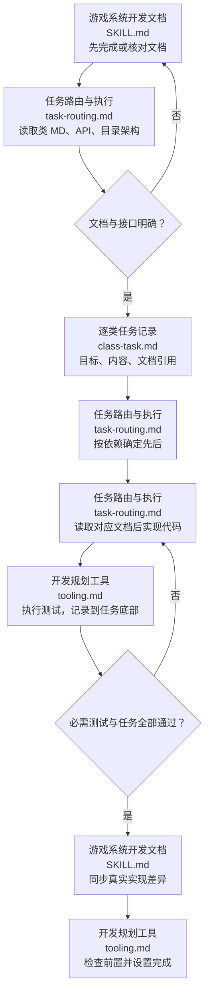

# 游戏系统开发规划

先文档，后规划。先由 [游戏系统开发文档](../game-system-development-documentation/SKILL.md) 明确系统、接口及脚本位置；本技能读取这些成果，把它们变成按类执行的任务。文档不足时先补对应文档，不在规划里另写一套设计。已有系统的改动也先核对并更新相关文档，再安排确实需要的实现工作；纯补录文档不制造代码任务。

## 执行流程

图中节点对应 [任务路由与执行](references/workflows/task-routing.md)、[逐类任务记录](references/contracts/class-task.md)、[开发规划工具](references/tooling.md)。没有执行条件则记录缺口，不把未运行的测试标成通过。

## 开始实现的门槛

首次写本次业务代码之前，必须已有对应类任务 MD，执行 `check/list` 核对前置与顺序，并将本类状态设为 doing；之后才能实现和测试。不能先实现再补任务并声称规划驱动。已有代码补录任务须如实写明是补录，不编造过去的执行过程。工具不会监控源码写入时间，执行者负责遵守这个顺序。

## 规划产物

任务入口 `docs/规划/<任务>/README.md`，各类任务放 `<client|server|shared>/<模块>/<类名>.md`，每目录都有 README。无类的语言按真实模块/脚本单元命名。入口只说明任务范围、文档入口和依赖执行顺序，链接各类任务；状态只存每类 MD，不维护第二份 TODO 表。

类任务只写目标、任务内容、对应文档、完成状态；必要的前置任务与必需测试写入精简 meta。文件底部 `## 测试过程` 记录真实命令/步骤、预期、实际、结果和证据。类职责、持有关系、生命周期、程序设计模式、流程图、接口声明、配置字段、UI 稿均链接文档，不复制。

实现前每次读对应 MD，沿链接查公开函数 API、目录架构与适用项目规范。现有框架已经提供能力时，给出准确接口、调用契约与差距，再确认是否重写；已有选择继续沿用，不重复询问。实现遵守文档规定的脚本位置和实际语言，不猜接口。

按 [开发规划工具](references/tooling.md) 使用 `scripts/planning_tool.py` 创建任务、记录测试、排序检查和设置完成。工具只修改显式指定任务根下的任务/README，不实现代码、不运行测试、不修改系统文档；结构通过不等于行为通过。

文档及规划由 docs 独立 Git 维护。测试过程只在规划类任务底部或链接的独立证据中；不进入正式文档。临时 Python 留仓库外或精确本地忽略，不提交；本技能的正式可复用工具可提交。发布或生产改动依用户授权，规划本身不扩大范围。
