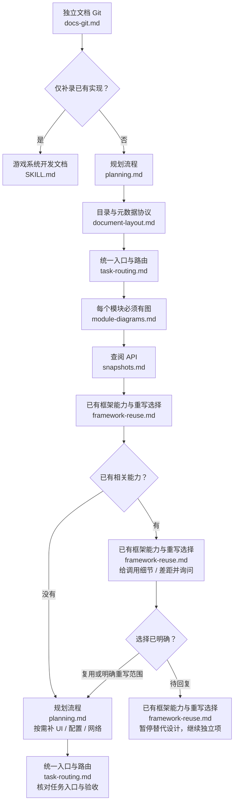
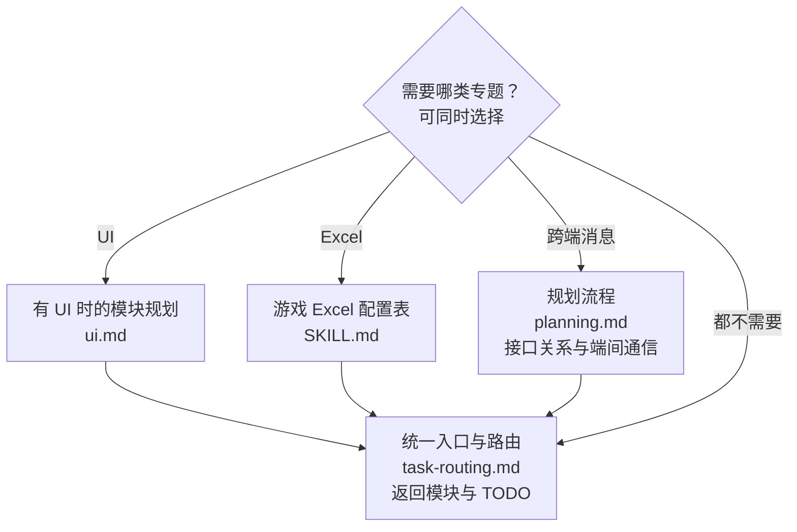
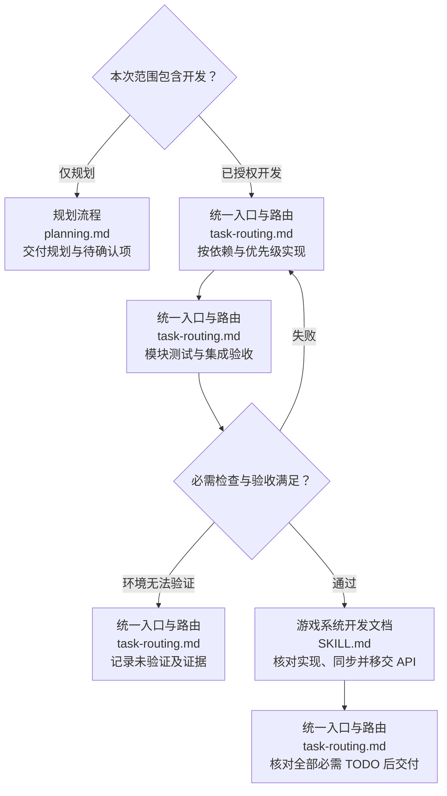

# 游戏系统开发规划

个人级游戏开发技能，跨项目、跨语言使用。先沿用项目指令和已有接口，不推测业务规则。图中操作节点可点击打开对应规范；节点名称与文件相对应，图下也保留 Markdown 链接，便于不支持 Mermaid 点击的阅读器使用。

## 1. 进入任务并完成规划

| 顺序 | 阅读规范 | 操作与产物 |
| --- | --- | --- |
| 进入 | [独立文档 Git](references/contracts/docs-git.md) | 确认 docs 独立仓库与已有改动；仅补文档转文档技能 |
| 调查 | [规划流程](references/workflows/planning.md) | 先读系统 Markdown / API；缺失、过期、冲突或需核对实现时才查相关源码 |
| 路由 | [目录与元数据协议](references/contracts/document-layout.md)、[统一入口与路由](references/workflows/task-routing.md) | docs/规划/<任务>/index.md 保存需求、模块关系、唯一 TODO、优先级/前置与验收；优化优先更新已有规划 |
| 分模块 | [每个模块必须有图](references/workflows/module-diagrams.md) | 每模块规划目录、职责、接口/关系、架构图和关键流程；不写具体实现、算法或伪代码 |
| 框架选择 | [已有框架能力与重写选择](references/workflows/framework-reuse.md) | 有现成能力先给准确接口、用法、生命周期/持有及差距，再询问复用或重写；已有选择不重复问，未确定不规划替代实现 |
| 定接口 | [查阅 API](../game-system-development-documentation/references/api/snapshots.md) | 本任务 api/client|server|shared/<模块>/ 生成原语言公开函数声明，标 planned/mixed；不冒充已实现接口 |
| 检查 | [统一入口与路由](references/workflows/task-routing.md) | 确认依赖可开展、链接/meta/接口一致、TODO 可验证；未知业务只阻塞依赖它的部分 |

采用 [任务模板](assets/templates/task.md)、[模块模板](assets/templates/plan.md)、[架构模板](assets/templates/architecture.md) 与 [流程模板](assets/templates/flows.md)，不保留未填写的空章节。

## 2. 按需扩展模块

- [UI](references/workflows/ui.md)：独立模块 ui.md 链接可直接打开的 HTML 设计稿；客户端业务在模块 View/view 集中 UI，服务端业务的客户端 UI 直接放模块根目录，沿用实际框架。使用 [UI 模板](assets/templates/ui.md)。
- [Excel](../game-excel-config/SKILL.md)：config.md 写字段注释、表关系、稳定 Id/外键、端开关、源表布局、导出类型/路径与读取接口，不只列字段名。
- [网络关系](references/workflows/planning.md)：涉及时独立网络专题 MD，说明真实协议、收发事件、请求/响应关联、权威端、取消/失败与接口关系，不假装已有网络接线。

无对应需求不创建空 UI、配置或网络产物。专题只维护一次，由任务入口和模块引用。

## 3. 按授权推进开发、测试与文档移交

根据已有授权判断范围，不为流程图重复索取确认。每次实现同步同一套 API、契约注释、版本及 Markdown；全部函数核对后由文档技能移交正式位置，planned/mixed 文件留在任务内。规划保留设计意图，不作为实现证据。只有必需 TODO、相关验证与文档/API 同步均完成才报告整项完成；未运行不能标验证通过。

## 工作约束

不改 SDK 缓存或生成投影；不强制重做局部优化的整套规划。提交/推送须有用户授权，技能本身不授权创建远程或推送。交付说明未完成项、验证范围和代码/docs 两仓库状态。

## 临时 Python 脚本
为扫描、生成或验证本次任务临时编写的 .py 可以保留，但不得加入 Git。优先放在仓库外的临时目录；需要保存在代码或 docs 工作树中时，使用各仓库本地 .git/info/exclude 精确忽略临时目录或文件，不使用全局 *.py 规则，以免隐藏正式源码。分别检查所属仓库的 git check-ignore 和暂存差异，确保临时脚本没有进入提交。发现本任务误暂存的临时脚本，仅撤销其暂存并保留文件，不影响用户已有暂存内容。项目正式 Python 源码、可复用工具和技能自带模板不属于临时脚本，不强制删除。
