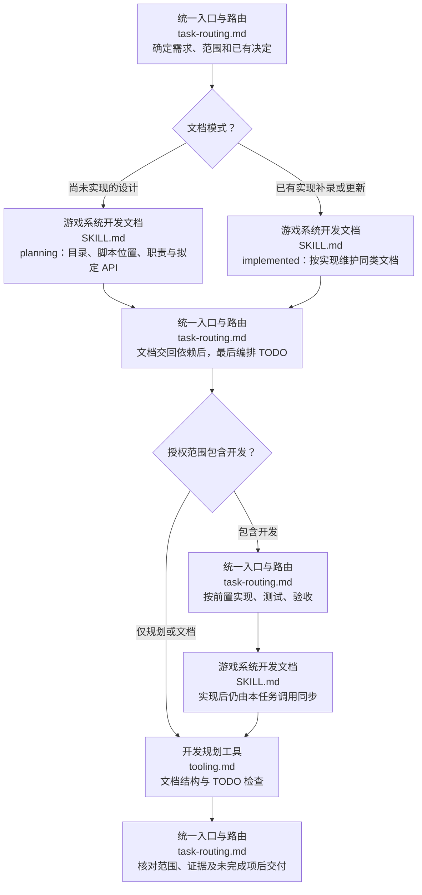

# 游戏系统开发规划

无论尚未开发、已有工程补录还是开发后的文档更新，都从本技能进入同一任务流程。文档生成全部调用 game-system-development-documentation，不在本技能保留第二套目录、meta、职责、API或流程图模板；本技能负责范围/模式、依赖和唯一 TODO，以及按已有授权协调开发与验证。

## 操作流程

1. 按 [统一入口与路由](references/workflows/task-routing.md) 保存需求与范围，沿用用户已确认选择，不重复索取已有授权。
2. 调用 [游戏系统开发文档](../game-system-development-documentation/SKILL.md)，传 planning 或 implemented 模式；文档技能先查已有能力、决定目录架构与脚本位置，再生成职责、API、调度/通信和各级 README。设计与现状不能混写，API 状态必须真实。
3. 文档返回依赖、交付门槛和未决项后，本技能最后补充唯一 TODO：先满足开发前置，再在就绪项中比较优先级；按 [TODO 模板](assets/templates/todo.md) 写清先做什么、再做什么和理由。已实现文档任务只安排本次核对/同步工作，不重新开发现成系统。
4. 按已有授权推进开发/测试/验收；每次实现变化仍调用同一文档技能更新，不回到旧的另一条文档入口。任务状态和证据只维护一份，正式文档不放 TODO/测试记录。
5. 使用 [开发规划工具](references/tooling.md) 检查：文档约束委托文档工具，规划工具只补查 TODO。未完成或未验证如实说明。

本技能不自动授权多代理、生产改造或推送；当前会话已有授权沿用。临时扫描/验证脚本放仓库外或精确本地忽略，不加入 Git；正式可复用工具仍放所属技能 scripts/，不分发测试代码。
