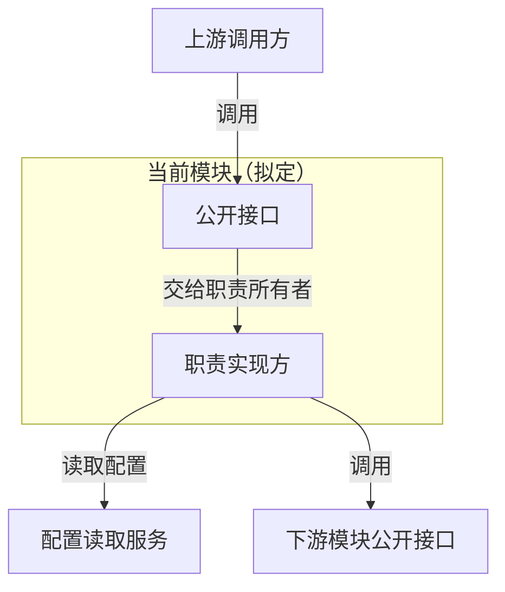

# <模块>依赖架构
[返回任务入口](../index.md)

## 模块边界与目标代码树
填写真实或拟定目录、类型职责、端归属和状态所有者。

## 依赖架构图
以下仅为格式示例，交付前替换为本模块真实或明确拟定节点和关系。

## 节点、接口与约束
| 图中节点 | 真实或拟定类型/模块 | 端及状态所有权 | API/职责文档链接 |
| --- | --- | --- | --- |
标清 planned、已有和待确认；说明依赖方向，图旁补充图例。

## 相关流程与验收
链接同模块 flows.md、relationships.md、verification.md 和任务 TODO。

图表可读性：优先纵向布局，超宽时按端或阶段拆图；节点精简并换行，关系保持完整。按实际文档预览宽度检查，避免整体缩小后文字无法直接阅读。
