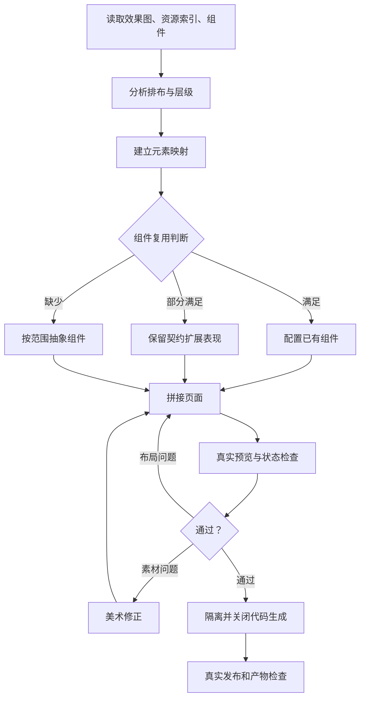

# UI 拼接与表现导出

输入目标 FGUI 工程、包和页面、效果图、资源库与已选风格。默认设计画布 1920×1080。只制作 UI 表现：可编辑页面、组件、布局映射、真实预览、资源导出和代码侧交接事项。

用户未显式指定库根时，先读取项目/任务仓库 `art-library.location.json`，将 `local_root` 相对定位文件解析，再读取实际库内定稿与资源索引。独立美术 Git 是新素材来源；旧技能示例仅作历史对照，不在其目录追加图。缺失或不搭配的素材由美术技能写回配置库；FGUI工程文件与导出继续属于目标UI项目。

背景独立处理，默认不加入场景背景。沿用选定风格文字档案，不能自行换风格。缺失或不搭配的素材交给 [game-layered-art](../game-layered-art/SKILL.md) 修正，再检查拼接效果。

1. 实际查看效果图及透明素材，读取资源 ID、版本、风格、原尺寸、接触锚点。将源图坐标映射到设计画布；素材名字、原尺寸等技术标注只进入审阅资料。
2. 按 [布局分析](references/analysis.md) 盘点包、XML、跨包引用、控制器和动画，填写映射清单。不能只按名称猜测组件用途。
3. 按 [组件抽象](references/components.md) 优先复用；页面专用放 `item/`，稳定跨功能组件才进公共包。更改公共组件前盘点所有引用并回归。
4. 用实际 FGUI 编辑器拼接；允许编辑已登记组件 XML，但新增资源 ID、包清单由编辑器维护。保存、重载并真实预览。文字用文本节点，主体保持比例，九宫格仅用于可拉伸底板。
5. 按 [隔离导出](references/export.md) 复制目标及依赖，关闭两处代码生成；通过已查阅的 MCPBridge 和发布插件真实发布。检查实际产物后才记录成功。

不实现点击业务、数据刷新、网络、禁用条件；不生成 C# 或自动绑定，不直接部署运行目录。编辑器不可用时保存源工程和待验证清单，明确没有完成预览/导出；HTML 或自行绘制图片不能冒充 FGUI 验收。

[工具与调用契约](references/tooling.md) · [示例](../examples/game-ui-composition/README.md)

[入口流程 SVG](../examples/game-ui-composition/review/flowcharts/entry.svg) · [组件流程 SVG](../examples/game-ui-composition/review/flowcharts/components.svg) · [导出流程 SVG](../examples/game-ui-composition/review/flowcharts/export.svg)
