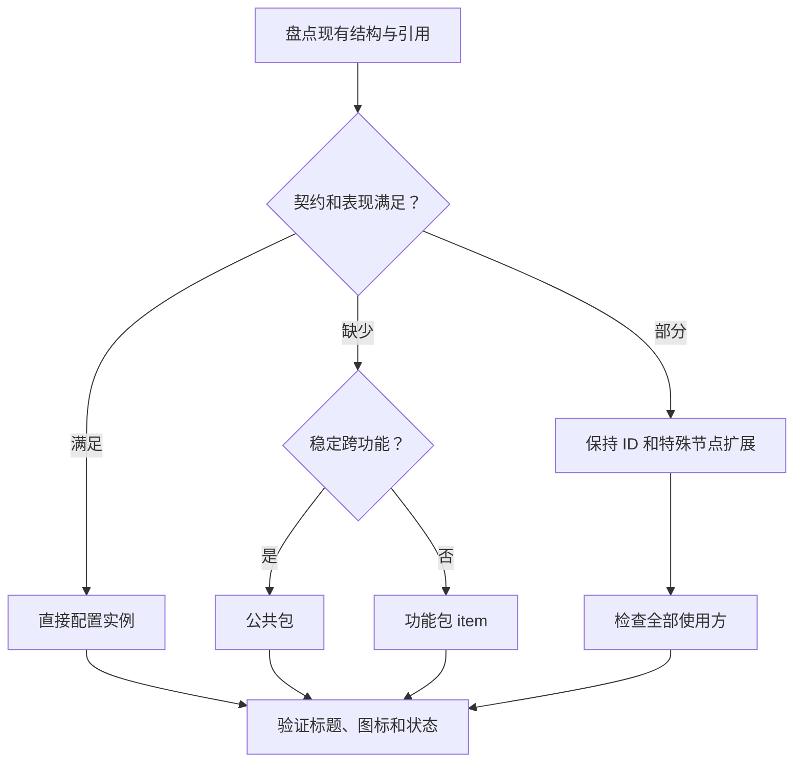

# 组件复用与表现契约

Button 拆成底板、主体 loader/icon、文本 title、点击区域和状态动画。保持原生 `title/icon` 特殊名称、Button 扩展、已有控制器页与动画名称；实例只配置标题、素材及允许的尺寸偏移。接触锚点不同可使用 loader 属性的实例覆盖，不能复制五套组件。

根点击矩形覆盖实际显示范围；透明边缘不要造成入口间点击重叠。根比例动画围绕合理 pivot，按下/回弹应复用已有结构并测试开始和结束状态。不能为了背景占位扩大点击区域。

资源条、卡片、列表项、进度条同样比较结构、变化点和复用范围。单次页面组件不强行公共化。底板九宫格须观察边框和角是否适合拉伸，主体用等比缩放。标题独立文本，验证字体、长标题、描边和溢出。

交付组件说明：职责、特殊节点、实例配置字段、尺寸/锚点、状态与动画、引用影响。只记录代码侧后续绑定事项，不生成处理程序。
