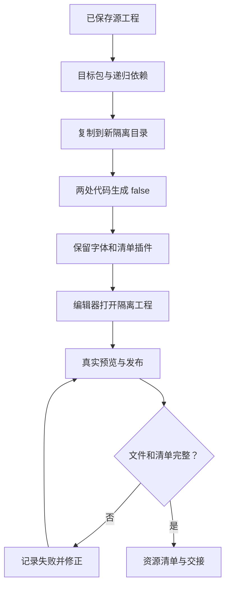

# 隔离发布与真实验收

先记录游戏源代码与绑定目录的哈希基线。隔离工程布局为 `export/FGUIProject/`，发布描述文件到 `../ui/AppBundle/user_files/fgui`；当前插件图集复制到工程父目录的 `ui/image/fgui`，所以隔离边界须包含父目录。

设置 `codeGeneration.allowGenCode=false`、`sceCodeGeneration.enabled=false`，代码路径也指向隔离目录。保留 `sceFontExport` 和 CSharpUiBindingExporter：名称虽含绑定，但其 onPublishEnd 在跳过代码时仍导出图集、字体、text/button/package manifests。每次适配先查实际插件源，不能假设其它版本具有相同行为。

所有保存路径相对工程，不接受绝对发布路径。复制后重新检查字体源和目标路径在隔离边界内。由编辑器实际发布，桥接返回 triggered 只代表已触发；必须等待文件落地，核对 FGUI 头、文件大小、清单哈希、跨包依赖、图集切片、字体、文字及按钮状态清单。

实看 1920×1080 预览，检查五实例共享同一 src、标题和主体独立配置、上下层接触、文字溢出、主体比例、点击区域及按下回弹。保存正常态与状态证据，不把静态 XML 检查写成动画验收通过。

完成后比较原代码哈希；导出交付不含 C#、绑定或业务脚本。不直接复制到运行工程。不可用时注明原因、源工程位置、已完成与未验证项。
