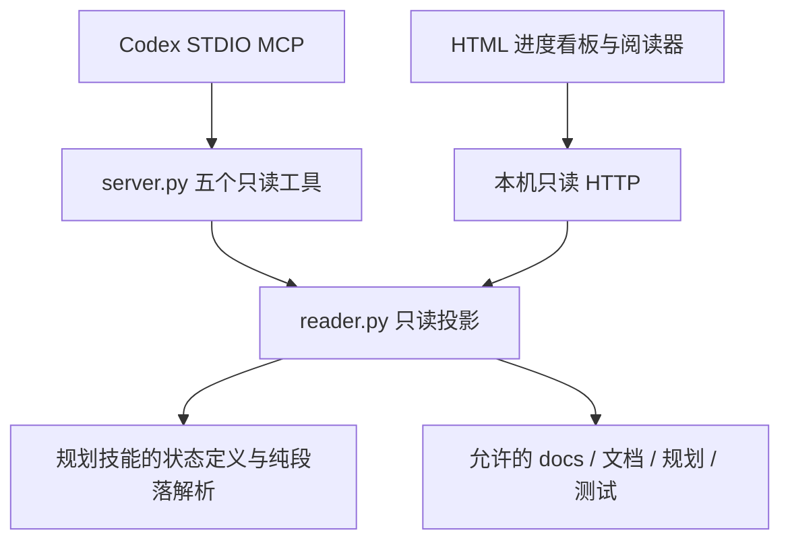

# 游戏开发进度工作台

只读 HTML 看板与 Markdown 阅读器，配合个人文档、规划和执行技能使用。最主要的页面是一个开发任务的**实现进度条与未完成工单**，点击工单后阅读对应 Markdown。

## 运行

需要 Python 3.12+、Node.js 20.19+（仅构建前端时需要）和已安装的游戏系统开发规划技能。

```powershell
python -m pip install -r requirements.txt
cd web
npm ci
npm run build
cd ..
python server.py --config projects.example.json --http-only
```

终端打印本机网页地址，在 Codex 浏览器侧栏或普通浏览器打开。`--port` 可指定端口；默认让系统分配空闲端口。服务只监听 127.0.0.1，不上传文档、调用模型或启动业务构建。

复制 projects.example.json 到个人 `projects.local.json`，在 projects 中配置多个 `id/name/docs`。docs 是项目的 docs 根，而非规划子目录；相对路径以配置文件为基准。planning_skill 同样支持相对路径。个人配置不提交 Git。

## 接入个人 MCP

构建前端后，将 server.py、reader.py 和 web/dist 部署到个人 MCP 目录，或直接引用本仓库目录：

```powershell
codex mcp add game-workbench --env PYTHONUTF8=1 --env PYTHONDONTWRITEBYTECODE=1 -- python <绝对路径>/server.py --config <个人配置绝对路径>
```

使用实际 Python 可执行文件路径可避免不同 Python 环境缺依赖。MCP 自动启动本机网页服务；调用 open_dashboard 获取入口，再在 Codex 浏览器侧栏打开。新增 MCP 配置后，若当前会话未发现工具，刷新客户端 MCP 或新建会话加载；配置成功不代表已经注入当前会话。

| 工具 | 输入 | 只读结果 |
| --- | --- | --- |
| list_projects | 无 | 已配置项目与可访问状态 |
| list_tasks | project，group 可选 | 任务分组，或工单与进度汇总 |
| get_task | project、group、path | 具体工单；path 是 docs 相对路径，防止重复 ID 混淆 |
| read_document | project、path | Markdown/代码/HTML 内容与 meta |
| open_dashboard | project/group/path 可选 | HTML 看板 URL，不自动启动业务或执行工单 |

所有 MCP 工具声明 readOnlyHint、非破坏性及封闭目录范围。HTTP `/api/*` 只接受 GET；不存在领取、编辑、勾选、运行测试或完成任务的接口。

## 阅读和进度口径

- 开发任务是 docs/规划 下的一级文件夹，以 README.md 为入口；旧 index.md 只读兼容，不迁移原文件。
- 主进度 = 所有已识别工单中已勾选工作项 / 全部工作项。零分母显示“—”，没有工单显示“暂无工单”。
- 验收完成数另计：需要 completed 标记、工作项全勾选、必需测试/验收最新 passed，以及前置一致。循环依赖、重复 ID 和失效上游不冒充完成；这仍不证明业务测试充分。
- 实现 100% 但验收尚未完成时显示“实现工作项已完成，待测试/验收”。未完成列表默认按入口 TODO 排序，完成项折叠。未知状态/损坏字段单列问题，进度仅汇总已识别工作项。
- 每 3 秒刷新工单、目录和当前文档。缺 TODO 暂按文件路径显示，不调用规划工具修复。
- 支持相对 MD、锚点、中文路径、图片、原语言 API 高亮、可点击 Mermaid 与放大缩放；未授权目录或坏链接明确报错。
- HTML 在 sandbox iframe 内展示，可使用本地 CSS/脚本演示交互；不允许同源权限、网络请求、表单提交、弹窗或访问看板接口。依赖外网/CDN 的设计稿需先按项目正常流程提供本地资源。

## 架构



reader.py 仅复用 task_store.py 的字段、状态与 section 纯函数，不调用 read/scan 的全局失败路径，不调用任何写操作。不会建立第二份状态数据库；浏览器只记住界面选择。隐藏目录、目录穿越与逃离 docs 的符号链接/目录联接被拒绝，单份文本上限 2 MiB。

测试程序和临时样例放在仓库外；验证结果见 [验证报告](verification.md)。前端 dist 与 node_modules 不提交，npm lockfile 固定依赖。
